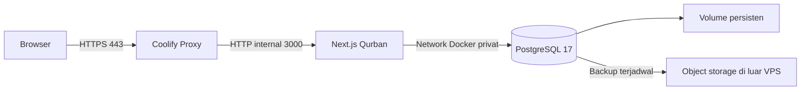

Rencana deploy Qurban ke VPS + Coolify
====================================

Rencana ini mengikuti Dockerfile dan struktur proyek saat ini. Asumsi awal: satu VPS, satu instance aplikasi, PostgreSQL pada VPS yang sama, dan database produksi baru. Domain contoh `qurban.example.org` dan `coolify.example.org` diganti dengan domain milik pengguna. Dokumen ini merupakan rencana; provisioning dan deployment belum dijalankan.

**1. Siapkan infrastruktur dan akses**

| Komponen | Rencana awal                                                                |
| -------- | --------------------------------------------------------------------------- |
| VPS      | Ubuntu 24.04 LTS, amd64, 4 vCPU, RAM 8 GB, SSD 80 GB atau lebih             |
| Lokasi   | Dekat mayoritas pengguna; Indonesia atau Singapura untuk pengguna Indonesia |
| Aplikasi | Dockerfile proyek, Next.js standalone, port internal 3000                   |
| Database | PostgreSQL 17 sebagai resource database terpisah di Coolify                 |
| Domain   | `qurban.example.org` untuk aplikasi; `coolify.example.org` untuk dashboard  |
| Backup   | Penyimpanan kompatibel S3 di luar VPS                                       |

Ukuran VPS di atas merupakan rekomendasi awal untuk menjalankan build, aplikasi, database, dan Coolify bersama; sesuaikan setelah mengukur penggunaan. Persyaratan minimum Coolify sendiri lebih kecil dan belum mewakili kebutuhan seluruh proyek. Gunakan VPS baru serta akses SSH berbasis key mengikuti [panduan instalasi Coolify](https://coolify.io/docs/start-with-self-hosted).

Alur trafik dan penyimpanan:



Satu VPS menyederhanakan operasional, tetapi gangguan VPS memengaruhi seluruh layanan. Backup di luar VPS menjadi bagian dari rancangan ini.

**2. Instal Coolify, atur DNS, dan aktifkan HTTPS**

1. Siapkan SSH key dan firewall provider, lalu instal rilis stabil Coolify mengikuti panduan resmi. Catat versi yang dipasang.
2. Buat akun administrator segera setelah instalasi dan simpan aksesnya di password manager.
3. Arahkan DNS `A` untuk kedua subdomain ke IPv4 VPS. Tambahkan `AAAA` hanya jika IPv6 VPS juga siap menerima trafik.
4. Atur domain dashboard dan domain aplikasi dengan protokol HTTPS. Proxy Coolify mengurus penerbitan serta pembaruan sertifikat setelah DNS dan port tersedia. [Panduan domain dan TLS](https://coolify.io/docs/core/networking/domains).

| Port masuk                        | Kebijakan                                                                                                                         |
| --------------------------------- | --------------------------------------------------------------------------------------------------------------------------------- |
| TCP 80 dan 443                    | Publik untuk web dan sertifikat                                                                                                   |
| TCP 22 atau port SSH yang dipakai | Batasi ke sumber administrasi yang diperlukan; pertahankan akses SSH Coolify                                                      |
| TCP 8000, 6001, 6002              | Untuk akses dashboard langsung saat setup; batasi ke IP admin, lalu tutup akses publik setelah dashboard melalui domain berfungsi |
| TCP 3000 dan 5432                 | Tetap internal                                                                                                                    |

Utamakan firewall provider sesuai [panduan firewall Coolify](https://coolify.io/docs/core/infrastructure/servers/firewall).

**3. Siapkan repository dan database produksi**

1. Commit dan push `Dockerfile`, `.dockerignore`, `next.config.ts`, serta dokumentasi. Pada saat rencana ini dibuat, perubahan Docker tersebut masih berada di working tree lokal.
2. Hubungkan repository ke Coolify memakai Git App atau deploy key. Pilih branch produksi yang disepakati, misalnya `main`.
3. Buat project `qurban` dan environment `production`.
4. Buat resource PostgreSQL 17 dengan database `qurban`, kredensial produksi tersendiri, serta volume persisten. Simpan nama resource dan informasi volumenya.
5. Tempatkan aplikasi dan database pada server serta **destination network yang sama**. Salin **Internal URL** database untuk `DATABASE_URL`; hostname mengikuti resource yang dibuat Coolify. [Koneksi database internal](https://coolify.io/docs/databases/#connect-an-application).
6. Jika sudah ada data operasional yang perlu dipindahkan, gunakan backup dan restore yang diuji pada database sementara, lalu tentukan waktu penghentian penulisan saat perpindahan. Bootstrap admin hanya untuk database baru yang belum memiliki panitia.

`docker-compose.yml` yang sudah tersedia melayani PostgreSQL lokal. Pada rancangan produksi ini, PostgreSQL dikelola sebagai resource Coolify tersendiri.

**4. Konfigurasikan aplikasi Dockerfile di Coolify**

| Pengaturan                  | Nilai                                                                          |
| --------------------------- | ------------------------------------------------------------------------------ |
| Source                      | Repository dan branch produksi                                                 |
| Build pack / Build strategy | Dockerfile                                                                     |
| Base Directory              | `/`                                                                            |
| Dockerfile Location         | `/Dockerfile`                                                                  |
| Docker Build Stage Target   | Kosong, sehingga memakai stage akhir `runner`                                  |
| Ports Exposes               | `3000`                                                                         |
| Domain                      | HTTPS, hostname `qurban.example.org`, target port internal `3000`              |
| Host port mapping           | Kosong; akses publik melalui proxy                                             |
| Start command               | Gunakan CMD image: `node server.js`                                            |
| Volume aplikasi             | Belum diperlukan; aset ikut image dan data operasional tersimpan di PostgreSQL |
| Auto deploy                 | Aktifkan setelah alur migrasi dan verifikasi rilis pertama selesai             |

Dockerfile sudah mengatur `HOSTNAME=0.0.0.0`, `PORT=3000`, serta user `node`. Atur **Build arguments** ke **Managed manually in Dockerfile** bila opsi tersebut tersedia; Dockerfile sudah mendeklarasikan `ARG NEXT_PUBLIC_APP_URL`. [Panduan Dockerfile Coolify](https://coolify.io/docs/applications/builds/dockerfile).

| Environment aplikasi  | Contoh/sumber nilai                     | Build | Runtime |
| --------------------- | --------------------------------------- | ----- | ------- |
| `NEXT_PUBLIC_APP_URL` | `https://qurban.example.org`            | Ya    | Ya      |
| `BETTER_AUTH_URL`     | `https://qurban.example.org`            | Tidak | Ya      |
| `BETTER_AUTH_SECRET`  | Nilai acak produksi minimal 32 karakter | Tidak | Ya      |
| `DATABASE_URL`        | Internal URL PostgreSQL dari Coolify    | Tidak | Ya      |

Periksa scope setiap variabel karena Coolify dapat mengaktifkan build dan runtime secara bersamaan secara default. Simpan secret sebagai nilai privat di Coolify. [Panduan environment variables](https://coolify.io/docs/applications/configuration/environment-variables).

Buat `BETTER_AUTH_SECRET` sekali di mesin tepercaya, lalu simpan untuk redeploy berikutnya:

```sh
node -e "console.log(require('node:crypto').randomBytes(48).toString('base64url'))"
```

Origin autentikasi dan aplikasi harus sama. Perubahan domain memerlukan penyesuaian URL dan build ulang karena `NEXT_PUBLIC_APP_URL` dimasukkan ke bundle saat build. Dockerfile memakai nilai sementara untuk validasi modul server selama build; kredensial produksi diberikan saat runtime. Build memerlukan akses internet untuk dependency dan font Google.

**5. Jalankan migrasi dan bootstrap melalui container maintenance**

Image `runner` hanya berisi output standalone dan aset. Image tersebut tidak menyediakan pnpm, Drizzle Kit, folder migrasi, maupun script bootstrap. Gunakan stage **builder** yang sudah ada untuk membuat image maintenance dari **commit yang sama** dengan rilis aplikasi.

Di checkout commit rilis pada VPS, isi nama network destination yang benar. Siapkan `/root/qurban-maintenance.env` dengan izin `600`, berisi hanya `DATABASE_URL` internal produksi. Simpan file ini di luar checkout dan gunakan editor agar kredensial tidak masuk command history.

```sh
export RELEASE_SHA="$(git rev-parse HEAD)"
export COOLIFY_NETWORK='ganti-dengan-nama-network-destination'

docker build --target builder \
  --build-arg NEXT_PUBLIC_APP_URL=https://qurban.example.org \
  -t "qurban-maintenance:$RELEASE_SHA" .

docker run --rm --network "$COOLIFY_NETWORK" \
  --env-file /root/qurban-maintenance.env \
  "qurban-maintenance:$RELEASE_SHA" pnpm db:migrate
```

Lanjutkan hanya setelah migrasi berhasil. Untuk database baru, buat admin pertama melalui terminal interaktif:

```sh
docker run --rm -it --network "$COOLIFY_NETWORK" \
  --env-file /root/qurban-maintenance.env \
  "qurban-maintenance:$RELEASE_SHA" pnpm admin:bootstrap
```

Script meminta nama dan email, lalu menampilkan password acak sekali. Simpan password tersebut di password manager. Bootstrap menolak database yang sudah memiliki panitia.

Migrasi dijalankan satu kali per rilis melalui langkah operator atau pipeline yang memeriksa exit code. Pre-deployment Coolify berjalan pada container lama dan dilewati saat deploy pertama; post-deployment tidak menjadikan rilis gagal apabila perintahnya gagal. Keduanya juga memakai image runtime proyek yang tidak memuat alat maintenance. [Perilaku deployment commands](https://coolify.io/docs/applications/builds/dockerfile#deployment-commands).

**6. Aktifkan health check, deploy, lalu verifikasi**

Pilih **Healthcheck > CMD** di Coolify. Gunakan Node yang tersedia di image untuk memeriksa API publik sekaligus koneksi database:

```sh
node -e "fetch('http://127.0.0.1:3000/api/public/qurban', {signal: AbortSignal.timeout(4000)}).then(r => process.exit(r.status === 200 ? 0 : 1)).catch(() => process.exit(1))"
```

Rekomendasi awal: interval 30 detik, timeout 5 detik, retries 3, start period 30 detik. Endpoint ini membaca data tanpa mengubahnya dan tersedia setelah migrasi. Image slim saat ini belum memasang `curl`/`wget`, yang diperlukan oleh mode HTTP bawaan Coolify. [Panduan health checks](https://coolify.io/docs/applications/configuration/health-checks).

Urutan deploy pertama: database sehat → migrasi → bootstrap → deploy aplikasi → health check sehat → verifikasi domain.

- Pastikan HTTPS dan sertifikat kedua domain valid.
- Buka halaman publik dan `/login`; periksa gambar, CSS, dan JavaScript.
- Pastikan `/api/public/qurban` memberi `200`, serta `/api/account` tanpa sesi memberi `401`.
- Login admin, buat periode awal, dan periksa akses dashboard setelah reload.
- Uji alur peserta, setoran, kuitansi, laporan, dan otorisasi pada environment staging dengan data sintetis sebelum membuka produksi untuk panitia.
- Periksa log aplikasi, pemakaian RAM saat build, CPU, disk, serta koneksi database.

Jalankan lint, typecheck, unit test, dan build pada commit rilis sebelum deploy. Pengujian backend yang membuat database uji memakai environment staging dan role uji tersendiri.

**7. Atur backup dan pemulihan sebelum penggunaan operasional**

| Area              | Rencana awal                                                                                                            |
| ----------------- | ----------------------------------------------------------------------------------------------------------------------- |
| PostgreSQL Qurban | Backup setiap jam; tambah backup sebelum migrasi dan sebelum perubahan besar                                            |
| Retensi database  | Lokal 2 hari, salinan S3 di luar VPS 30 hari; sesuaikan dengan ukuran dan kebutuhan arsip                               |
| Coolify           | Backup instance harian ke luar VPS; simpan `APP_KEY` dan SSH key secara terpisah di tempat aman                         |
| Verifikasi        | Pastikan upload berhasil dan lakukan uji restore ke database sementara sebelum penggunaan produksi, lalu secara berkala |
| Target pemulihan  | RPO maksimal 1 jam bila backup berjalan; target RTO awal 2–4 jam yang perlu dibuktikan lewat simulasi                   |

Coolify menyediakan jadwal backup database dan salinan ke penyimpanan kompatibel S3. Periksa timezone yang dipakai penjadwal. Status backup sukses perlu dilengkapi uji restore. [Backup database](https://coolify.io/docs/databases/backups), [restore database](https://coolify.io/docs/databases/restore).

Backup instance Coolify menyimpan konfigurasi dan kredensial, sedangkan data PostgreSQL Qurban membutuhkan backupnya sendiri. Simpan `APP_KEY` dari instance agar kredensial terenkripsi dapat dipulihkan. [Backup instance Coolify](https://coolify.io/docs/core/backup-and-recovery/instance-backup).

**8. Tetapkan prosedur rilis berikutnya dan rollback**

Alur awal: perubahan kode → pemeriksaan otomatis → uji staging → backup produksi → migrasi kompatibel → deploy commit yang sama → verifikasi. Aktifkan deployment otomatis hanya ketika perubahan skema juga memiliki langkah migrasi yang terkontrol. Rilis tanpa migrasi dapat langsung memakai alur deployment biasa setelah pemeriksaan lolos.

Simpan setidaknya tiga image rilis yang diketahui sehat dan periksa kebijakan cleanup server. Coolify dapat menjalankan kembali image lama yang masih disimpan; rollback memakai konfigurasi runtime saat ini dan tidak membatalkan migrasi atau transaksi database. [Panduan rollback](https://coolify.io/docs/applications/deployments/rollbacks).

Utamakan migrasi yang tetap kompatibel dengan versi aplikasi sebelumnya. Bila terjadi masalah pada kode, kembalikan image aplikasi dan verifikasi. Pemulihan database merupakan prosedur terpisah: hentikan penulisan, evaluasi transaksi setelah backup, lalu lakukan recovery dan rekonsiliasi agar setoran baru tidak hilang tanpa pencatatan.

Aktifkan notifikasi kegagalan deploy/backup, pantau HTTPS dari luar VPS, dan tetapkan penanggung jawab akses server serta pemulihan. Tinjau kapasitas setelah pemakaian nyata; build dapat dipindahkan ke CI/build server ketika mulai mengganggu layanan.

Data yang perlu ditentukan sebelum pelaksanaan: provider dan ukuran VPS, IP server, domain, URL repository/branch produksi, tujuan backup, serta apakah ada data lama yang akan dipindahkan. Rencanakan satu sesi setup dan satu sesi uji pemulihan sebelum aplikasi digunakan untuk pencatatan nyata.
