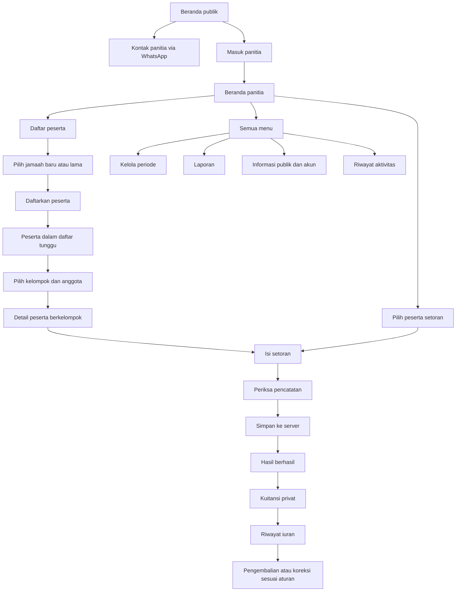

# Prototipe redesign mobile Qurban

Tanggal: 25 Oktober 2026  
Status: rancangan telah diterapkan pada tampilan web mobile  
Format: prototipe tekstual, wireframe layar, alur interaksi, dan spesifikasi visual

## 1. Tujuan dan batas pekerjaan

Mengubah pengalaman mobile Qurban menjadi terasa seperti aplikasi: ringkas, mudah dijangkau ibu jari, cepat untuk mencari peserta, dan nyaman untuk mencatat iuran. Inspirasi utamanya adalah pola aplikasi dompet digital seperti DANA, disesuaikan dengan pekerjaan panitia qurban.

Dokumen ini awalnya disusun sebagai tahap perancangan sebelum kode diubah. Setelah instruksi untuk memproses prototipe, rancangan diterapkan pada shell mobile, halaman, formulir, navigasi, dan alur transaksi. Aturan penyimpanan dan validasi server tetap menjadi dasar operasional aplikasi.

Sasaran implementasi berikutnya adalah tampilan web mobile yang terasa seperti aplikasi. Pembuatan aplikasi Android/iOS, pemasangan PWA, push notification, pembayaran digital, dan transaksi offline memerlukan lingkup pekerjaan tersendiri.

## 2. Dasar rancangan dan temuan audit

Rancangan disusun dari halaman dan alur yang sudah tersedia, bukan dari daftar fitur aplikasi keuangan umum.

| Bagian yang ditinjau                   | Dasar pemeriksaan                                                                               |
| -------------------------------------- | ----------------------------------------------------------------------------------------------- |
| Navigasi dan konteks periode           | `src/components/shared/dashboard-shell.tsx`                                                     |
| Daftar halaman internal                | `src/components/qurban/page-content.tsx`, `src/lib/qurban-demo.ts`                              |
| Peserta dan penempatan                 | `participants.tsx`, `registration-flow.tsx`, `participant-tags.tsx`                             |
| Kelompok dan pelaksanaan               | `src/components/qurban/groups.tsx`                                                              |
| Iuran, pengembalian, koreksi, kuitansi | `src/components/qurban/cash.tsx`                                                                |
| Periode, laporan, pengaturan           | `periods.tsx`, `reports.tsx`, `settings.tsx`                                                    |
| Halaman jamaah                         | `src/components/qurban/public-content.tsx`                                                      |
| Gaya dan responsivitas                 | `src/app/qurban.css`                                                                            |
| Gambar pratinjau yang tersedia         | `artifacts/frontend/dashboard-390.png`, `peserta-390.png`, `flow-form-peserta-mobile-final.png` |
| Aturan operasional                     | `README.md`, `rancangan.md`, serta command server yang sudah ada                                |

Temuan dari kode dan gambar pratinjau yang tersedia; belum dilakukan pengujian visual langsung terhadap aplikasi berjalan pada tahap ini:

1. Navigasi mobile masih memakai sidebar yang dibuka melalui hamburger. Menu rutin belum berada di area bawah layar.
2. Beranda menempatkan sapaan, banner besar, dan beberapa kartu statistik sebelum pekerjaan utama. Informasi penting dapat diringkas menjadi satu kepala halaman.
3. Halaman peserta menampilkan banyak ringkasan sebelum pencarian dan daftar. Pencarian perlu muncul lebih awal.
4. Form panjang masih berbentuk dialog di tengah layar. Pada ponsel, formulir penuh layar akan lebih nyaman ketika keyboard muncul.
5. Banyak informasi sekunder ditampilkan sekaligus. Nomor kontak, alamat, catatan, dan tindakan administratif dapat dipindahkan ke detail.
6. Identitas Qurban, logo, data per periode, dan kemampuan operasional sudah tersedia sebagai fondasi.

## 3. Arah desain

**Pembacaan brief:** aplikasi pengelolaan qurban untuk panitia, dengan bahasa visual aplikasi dompet digital yang ramah, ringkas, dan tepercaya.

Nama arah desain: **Qurban — Amanah dalam genggaman**.

### 3.1 Penggunaan referensi DANA

[Situs resmi DANA](https://www.dana.id/) dan [gambar aplikasi pada situs resmi](https://a.m.dana.id/resource/danaweb-v2/web-dana-app.png?lek=) menjadi referensi visual. Rancangan berikut merupakan adaptasi untuk Qurban; tidak mengklaim menyalin seluruh tampilan aplikasi DANA versi tertentu.

Yang diterapkan dalam konsep Qurban:

- Kepala halaman berwarna kuat dengan satu angka utama.
- Pintasan layanan menggunakan ikon dan label singkat.
- Permukaan putih membulat untuk daftar dan ringkasan.
- Navigasi bawah yang selalu mudah dijangkau pada halaman utama.
- Alur transaksi berurutan: peserta, nominal, pemeriksaan, hasil, kuitansi.
- Umpan balik jelas ketika ditekan, disimpan, berhasil, atau gagal.

Keputusan visual: menggunakan palet teal, sea green, mint, dan kuning lembut dari gambar referensi pengguna. Rasa seperti DANA datang dari susunan informasi, navigasi, dan interaksinya. Logo dan foto sapi tetap memakai aset milik proyek.

### 3.2 Prinsip pengalaman

1. Satu layar memiliki satu tindakan utama yang paling menonjol.
2. Beranda menjawab: berapa iuran terkumpul, apa yang perlu dilakukan, dan bagaimana mencatat setoran.
3. Daftar menjawab: bagaimana mencari, membedakan status, dan membuka detail.
4. Form menjawab: apa yang harus diisi, apakah datanya benar, dan apakah pencatatan sudah berhasil.
5. Istilah keuangan mengikuti domain: **setoran bersih**, **sisa kewajiban**, **pengembalian**, dan **kuitansi**.
6. Nominal utama tidak disebut saldo dompet atau saldo kas tersedia. Setoran bersih belum memperhitungkan seluruh pengeluaran panitia.
7. Publik melihat informasi program dan agregat; panitia melihat data operasional setelah login.

## 4. Sistem visual mobile

### 4.1 Warna

| Token rancangan           | Nilai                 | Pemakaian                                            |
| ------------------------- | --------------------- | ---------------------------------------------------- |
| Primary / teal            | `#287A74`             | Tombol utama, tab aktif, ikon, dan aksen             |
| Secondary / sea green     | `#55A9A0`             | Aksen dekoratif, garis workspace, warna grafik       |
| Mint                      | `#AEEED3`             | Navigasi aktif dan aksen pilihan                     |
| Lemon                     | `#FFF8B0`             | Pintasan setoran, penanda informasi, status tertunda |
| Primary soft              | `#EDF9F3`             | Latar pintasan dan informasi                         |
| Background                | `#F4FAF8`             | Latar layar                                          |
| Surface                   | `#FFFFFF`             | Daftar, form, sheet                                  |
| Text                      | `#183E3B`             | Teks utama                                           |
| Secondary text            | `#526D68`             | Keterangan                                           |
| Border                    | `#DCE9E5`             | Pemisah dekoratif; bukan satu-satunya penanda input  |
| Input border              | `#7E9790`             | Batas kontrol di atas permukaan putih                |
| Warning text / background | `#6B601E` / `#FFF8B0` | Tertunda, daftar tunggu, perhatian                   |
| Danger text / background  | `#B42318` / `#FEF3F2` | Void, pembatalan, kegagalan                          |

Empat warna acuan diambil langsung dari piksel gambar pengguna. Semua halaman memakai latar terang: layar `#F4FAF8`, permukaan putih, serta sidebar dan kepala beranda mint lembut `#EDF9F3`. Tema terang tetap aktif meskipun perangkat atau preferensi lama memakai mode gelap. Warna status selalu disertai teks atau ikon. Teal dengan teks putih memiliki rasio kontras sekitar 5,09:1; lemon memakai teks gelap agar terbaca.

### 4.2 Tipografi dan bentuk

- Font: Geist yang sudah dipakai proyek; tidak membutuhkan pergantian font.
- Angka ringkasan: 30–32 px, semibold, angka tabular.
- Judul layar: 20–24 px, semibold; judul panjang boleh dua baris.
- Judul bagian: 16–18 px, semibold.
- Isi dan label input: 14–16 px; input minimal 16 px.
- Keterangan: 12–13 px. Label navigasi bawah 11–12 px.
- Tombol utama setinggi 50–52 px; area sentuh semua kontrol minimal 44 × 44 px.
- Radius: 20 px untuk kartu utama, 14 px untuk input/tombol, 24 px untuk sudut atas sheet. Avatar bulat, chip berbentuk kapsul.
- Jarak tepi layar 16 px; jarak antarbagian 24 px; jarak antarkontrol 12 px.
- Bayangan tipis hanya untuk navigasi bawah dan permukaan yang memang mengambang. Daftar memakai divider dan ruang kosong.
- Ikon memakai keluarga Lucide yang sudah tersedia. Ikon dan label harus tetap mudah dimengerti tanpa warna.

### 4.3 Ukuran dan perilaku responsif

| Lebar viewport | Perilaku yang dirancang                                                                                                          |
| -------------- | -------------------------------------------------------------------------------------------------------------------------------- |
| 320–359 px     | Tetap satu kolom; nominal panjang dapat turun baris; pintasan menjadi dua kolom bila label tidak muat                            |
| 360–430 px     | Ukuran utama rancangan; empat pintasan per baris; navigasi bawah lima posisi                                                     |
| 431–767 px     | Tata letak aplikasi tetap; konten dibatasi sekitar 480 px dan dipusatkan                                                         |
| 768–1023 px    | Tata letak tablet yang ada dipertahankan pada tahap implementasi mobile; perlu cek transisi navigasi agar tidak muncul dua shell |
| ≥1024 px       | Tampilan desktop yang ada dipertahankan                                                                                          |

Frame acuan: **390 × 844 px**. Tetap perlu diuji pada 360 × 800, 375 × 667, dan 430 × 932 px. Wireframe di bawah menunjukkan urutan informasi, bukan gambar dengan skala piksel presisi.

Pada browser, tidak menambahkan jam, baterai, atau status bar ponsel palsu. Tinggi layar mengikuti viewport dinamis. Area bawah memperhitungkan safe area perangkat.

## 5. Struktur navigasi

### 5.1 Navigasi utama panitia

```text
┌─────────────────────────────────────────┐
│ Beranda   Peserta   [Setor]  Riwayat Menu│
└─────────────────────────────────────────┘
```

| Posisi  | Perilaku                 | Tujuan                                                              |
| ------- | ------------------------ | ------------------------------------------------------------------- |
| Beranda | Tab                      | `/dashboard`                                                        |
| Peserta | Tab                      | `/peserta`                                                          |
| Setor   | Tombol aksi utama        | Membuka alur catat setoran; menggunakan entry point `/iuran?baru=1` |
| Riwayat | Tab                      | `/iuran`                                                            |
| Menu    | Membuka layar menu penuh | Pusat akses kelompok, periode, laporan, publik, akun, aktivitas     |

**Setor adalah tombol aksi**, bukan tab dengan halaman kosong. Ketika alur dibuka, navigasi bawah disembunyikan dan diganti tombol form. Ketika dibatalkan, pengguna kembali ke konteks asal. Jika dibuka langsung dari tautan, tujuan kembali adalah riwayat iuran.

Menu penuh adalah rancangan tampilan baru di dalam shell mobile, tidak mengasumsikan adanya route `/menu`. Halaman sekunder seperti kelompok, laporan, dan periode masuk keluarga Menu. Detail peserta mengikuti tab Peserta; detail kuitansi mengikuti Riwayat.

### 5.2 Aturan shell

- Halaman utama: kepala halaman ringkas, pemilih periode, konten, navigasi bawah.
- Halaman detail: tombol kembali, judul, menu tindakan; tab keluarga tetap terlihat bila tidak ada tombol bawah khusus.
- Form panjang dan tahap transaksi: penuh layar, tombol kembali, indikator langkah jika diperlukan, tombol utama melekat di bawah; navigasi bawah disembunyikan.
- Bottom sheet: untuk memilih periode, filter, tindakan singkat, atau konfirmasi sederhana. Daftar pilihan yang panjang memakai layar penuh.
- Satu overlay aktif dalam satu waktu. Jangan menumpuk dialog di atas sheet.
- Area konten selalu menyediakan ruang untuk elemen bawah. Tombol form tetap terlihat ketika keyboard muncul dan tidak menutupi input terakhir.
- Tombol kembali menutup lapisan aktif dahulu. Form yang sudah diisi meminta keputusan **Lanjut mengisi** atau **Buang perubahan** sebelum ditinggalkan.
- Pencarian, filter, halaman daftar, dan posisi gulir dipulihkan ketika kembali dari detail.

### 5.3 Katalog layar dan pemetaan route

ID adalah identitas prototipe, bukan route baru. Varian tambah/ubah atau status tertentu memakai struktur layar yang sama.

| ID      | Layar / varian                                               | Route atau konteks yang tersedia      | Bentuk mobile                        |
| ------- | ------------------------------------------------------------ | ------------------------------------- | ------------------------------------ |
| P01     | Beranda publik                                               | `/`                                   | Halaman                              |
| P02     | Perkembangan dan jadwal publik                               | Bagian pada `/`                       | Bagian + detail penuh layar          |
| P03     | Cara bergabung dan FAQ                                       | Bagian pada `/`                       | Bagian + detail penuh layar          |
| P04     | Kontak panitia                                               | Bagian pada `/`                       | Bagian + tombol bawah                |
| A01     | Masuk panitia                                                | `/login`                              | Halaman                              |
| A02     | Sesi berakhir / akses tidak aktif                            | Kondisi autentikasi                   | Layar kondisi                        |
| N01     | Semua menu                                                   | Shell panitia                         | Penuh layar                          |
| N02     | Pilih periode                                                | Shell panitia                         | Sheet                                |
| N03     | Filter dan urutan daftar                                     | Daftar terkait                        | Sheet                                |
| D01     | Beranda panitia                                              | `/dashboard`                          | Halaman                              |
| PS01    | Daftar peserta                                               | `/peserta`                            | Halaman                              |
| PS02    | Peserta baru / jamaah lama                                   | Aksi tambah peserta                   | Pemilih penuh layar                  |
| PS03    | Tambah / ubah peserta                                        | Aksi pada `/peserta`                  | Form penuh layar                     |
| PS04    | Detail peserta                                               | `/peserta/[id]`                       | Halaman                              |
| PS05    | Batalkan / aktifkan kepesertaan                              | Detail peserta                        | Sheet konfirmasi                     |
| G01     | Daftar kelompok sapi                                         | `/kelompok`                           | Halaman                              |
| G02     | Tambah / ubah kelompok                                       | Aksi kelompok                         | Form penuh layar                     |
| G03     | Detail kelompok                                              | `/kelompok/[id]`                      | Halaman                              |
| G04     | Pilih / keluarkan anggota                                    | Aksi kelompok                         | Pemilih penuh layar / konfirmasi     |
| G05     | Kunci harga dan anggota                                      | Aksi kelompok                         | Form + ringkasan                     |
| G06     | Buka kembali / batalkan kelompok                             | Aksi kelompok                         | Konfirmasi beralasan                 |
| G07     | Catat pembelian                                              | Aksi kelompok                         | Form penuh layar                     |
| G08     | Catat pelaksanaan qurban                                     | Aksi kelompok                         | Form penuh layar                     |
| T01     | Riwayat iuran                                                | `/iuran`                              | Halaman                              |
| T02     | Pilih peserta transaksi                                      | `/iuran?baru=1` atau aksi dari detail | Pemilih penuh layar                  |
| T03     | Nominal dan serah terima                                     | Alur pencatatan                       | Form penuh layar                     |
| T04     | Periksa pencatatan                                           | Sebelum penyimpanan                   | Ringkasan penuh layar                |
| T05     | Pencatatan berhasil                                          | Setelah respons sukses                | Hasil penuh layar                    |
| T06     | Detail transaksi / kuitansi                                  | `/iuran/[id]`                         | Halaman                              |
| T07     | Pengembalian tunai                                           | Aksi pada iuran / detail peserta      | Varian T02–T05                       |
| T08     | Void transaksi                                               | Detail transaksi                      | Konfirmasi beralasan                 |
| T09     | Koreksi sekaligus                                            | Detail transaksi nyata                | Form bertahap                        |
| PE01    | Daftar periode                                               | `/periode`                            | Halaman                              |
| PE02    | Detail periode                                               | Kartu pada `/periode`                 | Detail penuh layar                   |
| PE03    | Buat / ubah periode                                          | Aksi periode                          | Form penuh layar                     |
| PE04    | Ubah status / sorotan publik                                 | Aksi periode                          | Konfirmasi beralasan sesuai tindakan |
| L01     | Ringkasan laporan                                            | `/laporan`                            | Halaman                              |
| L02     | Laporan peserta / kelompok / transaksi                       | Tab pada `/laporan`                   | Daftar per kategori                  |
| L03     | Ekspor dan cetak                                             | Aksi laporan / daftar                 | Sheet                                |
| S01     | Pengaturan informasi publik                                  | `/informasi-publik`                   | Form                                 |
| S02     | Pratinjau publik                                             | Tab pada `/informasi-publik`          | Pratinjau penuh layar                |
| AC01    | Profil saya dan daftar panitia                               | `/akun-panitia`                       | Halaman                              |
| AC02    | Tambah / ubah akun panitia                                   | Aksi akun                             | Form penuh layar                     |
| AC03    | Aktifkan / nonaktifkan akun                                  | Aksi akun                             | Konfirmasi beralasan                 |
| AC04    | Ubah kata sandi                                              | Aksi akun saya                        | Form penuh layar                     |
| H01     | Riwayat aktivitas                                            | `/aktivitas`                          | Halaman                              |
| H02     | Detail aktivitas                                             | Item riwayat                          | Detail penuh layar                   |
| X01–X06 | Loading, kosong, gagal, konflik, hanya baca, tidak ditemukan | Seluruh fitur                         | Kondisi bersama                      |

Seluruh halaman internal pada `/preview/...` mengikuti rancangan yang sama, dengan tanda **Mode contoh** yang tetap jelas. `/register` tetap mengarah ke login; tidak ada rancangan pendaftaran akun panitia secara publik.

## 6. Prototipe halaman publik dan login

### P01 — Beranda publik

Tujuan: jamaah memahami program, melihat perkembangan, dan menghubungi panitia tanpa login.

```text
┌──────────────────────────────────────┐
│ [logo] Qurban.       [Masuk panitia] │
│                                      │
│ Qurban 1448 H        [Dibuka]        │
│ Ringankan iuran.                     │
│ Besarkan kebaikan.                   │
│ Deskripsi singkat program panitia.   │
│                                      │
│ [foto sapi — rasio lebar, ringkas]   │
├──────────────────────────────────────┤
│ 18 jamaah     3 sapi     1 didanai   │
│                                      │
│ [Perkembangan] [Jadwal] [Cara ikut]  │
│ Agenda terdekat                      │
│ Batas daftar · 30 April 2027         │
│                                      │
│ Cara ikut qurban                  > │
│ Pertanyaan umum                   > │
│ Kontak panitia                    > │
├──────────────────────────────────────┤
│       [Hubungi panitia]              │
└──────────────────────────────────────┘
```

- CTA mengarah ke WhatsApp yang telah dikonfigurasi, dengan pesan awal yang sudah tersedia.
- Tidak menampilkan nama peserta, nomor kontak pribadi, iuran per orang, atau kuitansi.
- Tombol masuk panitia tetap terpisah dari ajakan jamaah menghubungi panitia.
- Halaman publik memakai satu CTA bawah; tidak memakai navigasi operasional panitia.
- Jika periode tidak menerima pendaftaran, label CTA menjadi **Tanya informasi**. Status penutupan tetap terlihat.
- Jika kontak belum diatur, tampilkan **Kontak belum tersedia** dan keterangan untuk kembali nanti; hindari tombol WhatsApp yang tidak berfungsi.

### P02 — Perkembangan dan jadwal

Urutan isi: nama periode → status → jumlah jamaah dan sapi → jumlah sapi didanai, dibeli, dan dilaksanakan → jadwal pendaftaran, pelunasan, dan pelaksanaan → tanggal informasi bila tersedia.

Timeline memakai label tanggal lengkap dan WIB jika menampilkan jam. Angka perkembangan memakai agregat publik yang sudah tersedia. Tidak menambahkan total iuran publik karena kontrak data publik saat ini tidak menyediakannya.

Pintasan dari P01 menggulir ke bagian terkait; rincian dapat dibuka penuh layar dengan tombol kembali. Tanpa periode sorotan, ganti angka dengan **Informasi periode akan diumumkan panitia**.

### P03 — Cara bergabung dan FAQ

Susunan: **Hubungi panitia → Panitia mendaftarkan → Ditempatkan ke kelompok → Setor tunai ke panitia → Terima kuitansi**. Ini menjelaskan alur operasional; bukan form pendaftaran mandiri.

FAQ memakai pertanyaan konkret: bagaimana mencicil, bagaimana penentuan target, kapan pelunasan, dan bagaimana menghubungi panitia. Jawaban mengikuti kebijakan program; hindari janji pengembalian atau nominal tetap yang belum ditetapkan.

### P04 — Kontak panitia

Isi: nama panitia, narahubung, alamat yang telah diatur, dan tombol WhatsApp. Tampilkan nomor kontak program, bukan kontak peserta. Kembali ke P01 menjaga posisi gulir. Membuka WhatsApp tidak otomatis mengirim pesan.

### A01 — Masuk panitia

```text
┌──────────────────────────────────────┐
│ < Kembali                           │
│                                      │
│ [logo Qurban]                       │
│ Selamat datang, Panitia              │
│ Masuk untuk mengelola amanah jamaah. │
│                                      │
│ Email                               │
│ [nama@contoh.id                    ] │
│ Kata sandi                          │
│ [••••••••                  Lihat ] │
│                                      │
│ [             Masuk               ] │
│ Akun dibuat oleh admin panitia.     │
│                                      │
│ Kembali ke informasi qurban          │
└──────────────────────────────────────┘
```

State: normal, sedang masuk, validasi kolom, kredensial ditolak, dan koneksi gagal. Jangan tampilkan tombol OTP, login sosial, registrasi publik, atau lupa kata sandi otomatis karena alurnya belum tersedia. Pengguna yang sudah masuk tetap diarahkan sesuai perilaku autentikasi yang ada.

### A02 — Sesi berakhir / akses tidak aktif

- Sesi berakhir: **Sesi Anda berakhir. Masuk kembali untuk melanjutkan.** CTA **Masuk kembali**.
- Akses tidak aktif: **Akses panitia tidak tersedia. Hubungi pengelola panitia.** CTA kembali ke halaman publik.
- Pengisian yang belum tersimpan tidak dinyatakan berhasil. Data sensitif dan kata sandi tidak disimpan ke penyimpanan browser untuk memulihkan sesi.

## 7. Shell aplikasi, menu, dan beranda

### N01 — Semua menu

```text
┌──────────────────────────────────────┐
│ Semua menu                      [X] │
│                                      │
│ [AF] Ahmad Fauzi                     │
│ Admin panitia            [Profil >] │
│                                      │
│ PENGELOLAAN                          │
│ [Peserta] [Kelompok] [Iuran]         │
│ [Periode] [Laporan]  [Aktivitas]     │
│                                      │
│ PENGATURAN                           │
│ Informasi publik                  > │
│ Akun panitia                      > │
│ Lihat halaman publik              > │
│                                      │
│ Keluar dari akun                     │
└──────────────────────────────────────┘
```

Profil menuju bagian akun saya pada AC01. Nama dan inisial memakai akun yang benar-benar sedang login, bukan selalu akun pertama dalam daftar. Tidak menambahkan level akun, peran bendahara, atau hak akses baru. Keluar meminta konfirmasi singkat lalu menjalankan logout yang tersedia.

### N02 — Pilih periode

Sheet berisi judul **Periode pengelolaan**, daftar nama/tahun, status, dan tanda pilihan aktif. Pisahkan berjalan/draf dari selesai/arsip. Arsip memiliki label **Hanya baca**. Tombol **Kelola periode** menuju PE01.

Memilih periode memuat ulang data dalam konteks periode tersebut. Jika dipanggil dari detail, kembali ke daftar induknya agar tidak menampilkan detail milik periode lama. Jangan menawarkan pergantian periode di tengah form transaksi tanpa menyelesaikan atau membuang form terlebih dahulu.

### N03 — Filter daftar

Sheet berisi pilihan sesuai fitur, jumlah filter aktif, tombol **Atur ulang**, dan **Terapkan**. Pencarian tetap di layar daftar. Filter kepesertaan dan status pembayaran adalah dua hal terpisah.

Filter baru yang belum didukung halaman sekarang ditandai sebagai peningkatan UI pada bagian 13. Tidak boleh ada filter dalam prototipe interaktif berikutnya yang terlihat berfungsi tetapi tidak memengaruhi data.

### D01 — Beranda panitia

```text
┌──────────────────────────────────────┐
│ [logo] Qurban.                  [AF]│
│ Assalamu’alaikum, Ahmad              │
│ [Qurban 1448 H                  v]  │
│                                      │
│ SETORAN BERSIH                  [◉]│
│ Rp44.200.000                        │
│ █████████████░░░░░░ 65%             │
│ dari kewajiban Rp68.000.000         │
│ Sisa kewajiban Rp23.800.000         │
├──────────────────────────────────────┤
│ [Setor] [Peserta] [Kelompok] [Lapor] │
│                                      │
│ 18 peserta    3 sapi    8 lunas      │
│                                      │
│ Perlu ditindaklanjuti                │
│ 1 peserta belum berkelompok       > │
│ Pelunasan · 10 Mei 2027           > │
│                                      │
│ Transaksi terbaru       Lihat semua │
│ Hasan Basri              +Rp500.000 │
│ Setoran · 24 Okt             Valid │
│ Rina Marlina           +Rp2.500.000 │
│ Setoran · 22 Okt             Valid │
│                                      │
│ Kelompok sapi            Lihat semua│
│ Sapi 01 · 7/7 · Siap dibeli       > │
├──────────────────────────────────────┤
│ Beranda Peserta [Setor] Riwayat Menu│
└──────────────────────────────────────┘
```

Angka dan identitas pada seluruh wireframe adalah **data ilustrasi**, bukan pembacaan database nyata. Contoh ringkasan: 18 peserta aktif, 17 sudah berkelompok, 1 menunggu; kewajiban peserta berkelompok Rp68.000.000, setoran bersih Rp44.200.000, sisa Rp23.800.000. Progress 65%. Angka ini dipakai untuk menunjukkan hierarki.

- Area berwarna teal berisi konteks dan nominal; tidak memakai banner promosi tinggi.
- Tombol mata menyamarkan nominal pada layar perangkat, tanpa mengubah perhitungan.
- Empat pintasan: catat setoran, peserta, kelompok, laporan.
- Tindak lanjut berasal dari data: daftar tunggu, sisa kewajiban, atau jadwal. Tidak membuat pusat notifikasi baru.
- Tampilkan paling banyak tiga transaksi dan dua kelompok; sisanya melalui **Lihat semua**.
- Grafik bulanan ditempatkan di laporan, agar aktivitas harian lebih cepat dijangkau.
- Catatan **Setoran bersih bukan saldo kas tersedia** dapat dibuka dari label informasi dan tetap tertulis pada laporan.
- Saat belum ada periode, tampilkan urutan **Isi profil panitia → Buat periode → Buat kelompok → Buka pendaftaran**. Setelah pendaftaran dibuka, lanjutkan pendaftaran peserta, penempatan, dan setoran.

## 8. Prototipe peserta

### PS01 — Daftar peserta

```text
┌──────────────────────────────────────┐
│ Peserta                    [Tambah]│
│ Qurban 1448 H                  [v] │
│ [Cari nama / nomor peserta       ] │
│ [Semua 18] [Belum berkelompok 1]    │
│ [Filter]                 18 peserta│
├──────────────────────────────────────┤
│ [AF] Ahmad Fauzi              Aktif│
│ Q48-001 · Sapi 02                  │
│ Terkumpul Rp1.500.000              │
│ Sisa Rp2.500.000                  >│
├──────────────────────────────────────┤
│ [MR] Muhammad Ridwan          Aktif│
│ Q48-002 · Sapi 01                  │
│ Lunas · Rp4.000.000               >│
├──────────────────────────────────────┤
│ [SA] Siti Aminah              Aktif│
│ Q48-003 · Belum berkelompok        │
│ Belum dapat menerima setoran     >│
├──────────────────────────────────────┤
│ Menampilkan 1–8 dari 18             │
│ [Sebelumnya]          [Berikutnya] │
├──────────────────────────────────────┤
│ Beranda Peserta [Setor] Riwayat Menu│
└──────────────────────────────────────┘
```

Daftar muncul segera setelah pencarian dan chip. Alamat dan nomor telepon pindah ke detail. Ringkasan cukup satu baris, bukan empat kartu besar. Setiap item memiliki area ketuk lebar.

Filter awal mempertahankan kategori kepesertaan: semua, belum berkelompok, sudah berkelompok, dibatalkan. Filter pembayaran tambahan, jika diterapkan, memakai label terpisah: belum setor, mencicil, lunas, kelebihan. Ekspor tetap dapat diakses melalui menu tindakan.

### PS02 — Pilih peserta baru atau jamaah lama

Dua pilihan jelas: **Daftarkan jamaah baru** dan **Gunakan data jamaah lama**. Direktori jamaah lama memiliki pencarian nama/kontak dan identitas pembeda. Pilihan jamaah lama mengisi identitas dari direktori; pengguna tetap memeriksa tanggal dan catatan pendaftaran.

Jamaah yang sudah terdaftar pada periode ini tidak dapat didaftarkan ulang. Kepesertaan yang dibatalkan diarahkan ke pengaktifan kembali, sesuai aturan server. Nomor telepon keluarga tidak dianggap identitas unik tunggal.

### PS03 — Tambah / ubah peserta

```text
┌──────────────────────────────────────┐
│ < Tambah peserta                    │
│ Qurban 1448 H                       │
│                                      │
│ Nama lengkap                        │
│ [                                ] │
│ Nomor WhatsApp                      │
│ [62                              ] │
│ Gunakan format 62812…               │
│ Alamat · opsional                   │
│ [                                ] │
│ Tanggal pendaftaran                 │
│ [25 Oktober 2026               ▣] │
│ Catatan · opsional                  │
│ [                                ] │
│                                      │
│ Setelah tersimpan, peserta dapat    │
│ ditempatkan ke kelompok.            │
├──────────────────────────────────────┤
│ [        Daftarkan peserta        ]│
└──────────────────────────────────────┘
```

Sukses menampilkan ringkasan peserta dengan **Tempatkan ke kelompok** dan **Lihat peserta**. Tombol pertama membuka G01 dengan konteks peserta yang baru dibuat, menggunakan alur penempatan yang sudah ada. Tanpa kelompok tersedia, jelaskan langkah membuat kelompok.

Varian ubah mengisi data lama, menampilkan nomor peserta tetap, dan memakai CTA **Simpan perubahan**. Tanggal pendaftaran hanya tampil pada alur yang memang dapat mengubahnya. Kesalahan muncul di dekat kolom terkait.

### PS04 — Detail peserta

```text
┌──────────────────────────────────────┐
│ < Detail peserta               [⋯] │
│ [AF] Ahmad Fauzi                    │
│ Q48-001 · Aktif · Qurban 1448 H     │
│                                      │
│ Target                Rp4.000.000   │
│ Setoran bersih         Rp1.500.000   │
│ Sisa kewajiban         Rp2.500.000   │
│ ███████░░░░░░░░░░░ 37,5%            │
│                                      │
│ Kelompok · Sapi 02                > │
│ Kontak dan alamat                 v │
│ Catatan                           v │
│                                      │
│ Riwayat iuran                       │
│ 20 Okt · Setoran       +Rp1.000.000 │
│ 10 Okt · Setoran         +Rp500.000 │
├──────────────────────────────────────┤
│ [         Catat setoran           ]│
└──────────────────────────────────────┘
```

CTA menggantikan navigasi bawah pada detail ini. Peserta terpilih dibawa ke T03, sehingga tidak perlu dipilih ulang. Tindakan ubah, pengembalian, dan pembatalan berada pada menu tindakan.

Varian penting: peserta menunggu menampilkan **Tempatkan ke kelompok**; peserta lunas menampilkan status lunas dan riwayat; peserta dengan kelebihan menonjolkan jumlah yang perlu dikembalikan; peserta batal menampilkan alasan dan tindakan pengaktifan jika memenuhi aturan. Tidak menampilkan target Rp0 sebagai kesan sudah lunas bagi daftar tunggu.

### PS05 — Batalkan / aktifkan kembali

Konfirmasi memuat identitas, akibat tindakan, alasan wajib, dan CTA spesifik. Pembatalan hanya dilanjutkan setelah setoran bersih nol dan syarat kelompok terpenuhi. Jika terhalang, tampilkan alasan serta tautan ke penyelesaian yang relevan.

Pengaktifan kembali memakai kepesertaan lama, menjaga riwayat, dan mengembalikan peserta ke daftar tunggu. Tidak otomatis mengembalikan slot kelompok lama.

## 9. Prototipe kelompok sapi

### G01 — Daftar kelompok

```text
┌──────────────────────────────────────┐
│ < Kelompok sapi             [Tambah]│
│ Qurban 1448 H                  [v] │
│ [Cari kelompok                    ]│
│ [Semua] [Pembentukan] [Pengumpulan] │
│ [Filter status]                     │
│                                      │
│ Sapi 01                 Siap dibeli │
│ 7/7 anggota · Harga final terkunci  │
│ Rp28.000.000 / Rp28.000.000         │
│ ████████████████████ 100%          >│
│                                      │
│ Sapi 02            Pengumpulan iuran│
│ 7/7 anggota · Target masih estimasi │
│ Rp14.700.000 terkumpul              │
│ ██████████░░░░░░░░░░              >│
│                                      │
│ Sapi 03                 Pembentukan│
│ 3/7 anggota · 4 tempat tersedia     │
│ [Lihat anggota]                    >│
├──────────────────────────────────────┤
│ Beranda Peserta [Setor] Riwayat Menu│
└──────────────────────────────────────┘
```

Filter mencakup pembentukan, pengumpulan, siap dibeli, dibeli, dilaksanakan, dan dibatalkan. Status tertulis; progress uang tidak digunakan sebagai satu-satunya bukti kelompok siap.

Jika datang dari PS03/PS04 untuk penempatan, tampilkan konteks **Tempatkan Siti Aminah** di atas daftar. Kelompok penuh atau terkunci tetap dapat dilihat, tetapi tidak bisa dipilih sebagai tujuan penempatan.

### G02 — Tambah / ubah kelompok

Form penuh layar: nama kelompok, jenis sapi sesuai field yang tersedia, jumlah anggota disepakati 1–7, estimasi total biaya, dan catatan. Tampilkan kalkulasi **Estimasi per peserta** yang mengikuti jumlah anggota disepakati, bukan jumlah anggota yang kebetulan sudah terisi.

Bagian anggota menampilkan ringkasan dan tombol **Pilih peserta**, menuju G04. Pilihan pada kelompok baru merupakan pilihan sementara; belum menempatkan peserta sampai kelompok disimpan. CTA **Buat kelompok** atau **Simpan perubahan**. Field yang terkunci tidak tampak dapat diedit.

### G03 — Detail kelompok

```text
┌──────────────────────────────────────┐
│ < Sapi 02                      [⋯] │
│ Pengumpulan iuran                   │
│ [Ringkasan] [Anggota] [Pelaksanaan] │
│                                      │
│ Estimasi total        Rp28.000.000  │
│ Target per peserta     Rp4.000.000  │
│ Anggota                          7/7│
│ Harga dan anggota belum dikunci.   │
│                                      │
│ Progres iuran                       │
│ Setoran bersih        Rp14.700.000  │
│ Sisa kewajiban        Rp13.300.000  │
│                                      │
│ Anggota                             │
│ [AF] Ahmad Fauzi          Mencicil >│
│ [NA] Nur Aisyah           Lunas    >│
│ ... seluruh anggota dapat dibuka  │
├──────────────────────────────────────┤
│ [      Kunci harga dan anggota     ]│
└──────────────────────────────────────┘
```

Tindakan utama mengikuti kondisi kelompok:

| Kondisi                         | CTA utama / informasi                     |
| ------------------------------- | ----------------------------------------- |
| Anggota belum lengkap           | Tambah anggota                            |
| Anggota lengkap, belum terkunci | Kunci harga dan anggota                   |
| Terkunci, masih ada kewajiban   | Lihat iuran anggota                       |
| Siap dibeli                     | Catat pembelian                           |
| Sudah dibeli                    | Catat pelaksanaan                         |
| Sudah dilaksanakan              | Lihat ringkasan pelaksanaan               |
| Dibatalkan / periode hanya baca | Informasi status; tidak ada tombol mutasi |

Detail anggota menuju PS04. Label **Estimasi** berubah menjadi **Final** setelah harga dikunci. Harga beli tetap ditampilkan terpisah dari total biaya final. Tab Pelaksanaan menampilkan harga beli, tanggal pembelian, tanggal pelaksanaan, dan catatan yang tersedia.

### G04 — Pilih / keluarkan anggota

```text
┌──────────────────────────────────────┐
│ < Pilih anggota                     │
│ Sapi 03 · Terisi 3 dari 7           │
│ [Cari peserta belum berkelompok   ]│
│                                      │
│ [✓] Siti Aminah         Q48-003    │
│ [ ] Nama peserta lain   Q48-019    │
│                                      │
│ Dipilih 1 · Tersisa 3 tempat        │
├──────────────────────────────────────┤
│ [         Tambahkan 1 peserta      ]│
└──────────────────────────────────────┘
```

Hanya peserta aktif yang belum berkelompok pada periode yang sama dapat dipilih. Pilihan tidak melampaui kapasitas yang disepakati. Anggota saat ini ditampilkan terpisah bila perlu, bukan checkbox yang mudah terhapus tanpa sengaja.

Pemilih anggota menggunakan multi-select: dropdown pada desktop dan panel bawah pada ponsel. Pencarian dapat memakai nama atau nomor peserta. Daftar tetap terbuka saat beberapa checkbox dicentang; pilihan ditampilkan sebagai tag yang dapat dihapus. Setelah kapasitas terpenuhi, pilihan baru dinonaktifkan sementara peserta terpilih tetap dapat dibatalkan centangnya.

Tombol **Selesai** menutup pemilih dan kembali ke form tanpa menyimpan ke server. Pada kelompok yang sudah ada, gunakan **Tambah N peserta** atau **Tambahkan ke kelompok** untuk menyimpan penempatan. Pada form kelompok baru/ubah, gunakan **Simpan perubahan**. Mengeluarkan anggota memerlukan konfirmasi dan setoran bersih nol; peserta kembali ke daftar tunggu.

### G05 — Kunci harga dan anggota

Form menampilkan total biaya final, daftar/jumlah anggota, target final per peserta, selisih pembulatan, serta catatan kesepakatan. Layar pemeriksaan memperlihatkan perubahan target sebelum dikunci. CTA **Kunci harga dan anggota**.

Target dibulatkan ke atas sesuai aturan yang ada. Jika target baru menimbulkan kelebihan setoran, tampilkan jumlahnya dan arah penyelesaian; status siap tetap mengikuti pemeriksaan seluruh peserta.

### G06 — Buka kembali / batalkan kelompok

- Buka kembali: tampilkan akibat pada harga dan komposisi, alasan wajib, serta pembatasan sebelum pembelian.
- Batalkan: tampilkan jumlah anggota dan kewajiban yang harus dibereskan; alasan wajib. Penolakan server dijelaskan tanpa menghapus riwayat.
- Keduanya tindakan terpisah dengan judul dan CTA masing-masing, tidak digabung dalam tombol **Ubah status** yang ambigu.

### G07 — Catat pembelian

Form: harga beli sapi, tanggal pembelian, dan catatan. Ringkasan menampilkan total biaya final dan status kesiapan. Jelaskan bahwa harga dan anggota tidak dapat diubah setelah pembelian dicatat. CTA **Catat pembelian** setelah pengguna memeriksa ringkasan.

Kelompok harus memenuhi aturan siap dibeli; total uang yang terlihat cukup tidak menggantikan pemeriksaan tiap anggota.

### G08 — Catat pelaksanaan qurban

Form: tanggal pelaksanaan dan ringkasan kelompok yang telah dibeli. CTA **Catat pelaksanaan**. Sesudah berhasil, tampilkan status **Sudah dikurbankan**, tanggalnya, dan tautan ringkasan kelompok. Tidak menambahkan unggah dokumentasi karena belum ada fiturnya.

## 10. Prototipe iuran, transaksi, dan kuitansi

### T01 — Riwayat iuran

```text
┌──────────────────────────────────────┐
│ Riwayat iuran                  [⋯] │
│ Qurban 1448 H                   [v]│
│ Setoran bersih         Rp44.200.000 │
│ [Cari peserta / nomor kuitansi    ]│
│ [Semua] [Setoran] [Kembali] [Void]  │
│                                      │
│ 24 Oktober 2026                     │
│ [↓] Hasan Basri         +Rp500.000  │
│ KWT-1448-0015 · 10.20 WIB    Valid >│
│                                      │
│ 23 Oktober 2026                     │
│ [↓] Yusuf Hidayat       +Rp500.000  │
│ KWT-1448-0014 · 09.30 WIB    Valid >│
│                                      │
│ [↑] Ahmad Fauzi         −Rp200.000  │
│ Pengembalian · nomor kuitansi     >│
│                                      │
│ [↓] Transaksi yang dibatalkan       │
│ Rp500.000                    Void >│
│                                      │
│ [Sebelumnya]          [Berikutnya] │
├──────────────────────────────────────┤
│ Beranda Peserta [Setor] Riwayat Menu│
└──────────────────────────────────────┘
```

Baris pengembalian dan void di atas adalah contoh varian tampilan, bukan bagian dari kalkulasi ringkasan contoh beranda. Nominal diberi tanda dan label jenis, tidak hanya warna. Void tetap terlihat dengan alasan di detail dan tidak masuk agregat valid.

Menu tindakan memuat **Catat pengembalian** dan akses ekspor yang tersedia. Pengelompokan per tanggal merupakan peningkatan presentasi; pencarian, filter jenis, dan pagination tetap dipertahankan.

### T02 — Pilih peserta untuk setoran

Penuh layar dengan judul **Catat setoran**, pencarian, dan daftar peserta yang memenuhi syarat. Setiap baris: nama, nomor peserta, kelompok, dan sisa kewajiban. Peserta lunas, batal, menunggu kelompok, atau tidak memenuhi jadwal tidak dapat dipilih; beri penjelasan bila daftar kosong.

Setelah memilih, lanjut T03. Dari PS04, peserta sudah terisi dan langkah ini dilewati. Periode transaksi dikunci selama alur; nama periode tetap terlihat.

### T03 — Isi nominal dan serah terima

```text
┌──────────────────────────────────────┐
│ < Catat setoran                     │
│ Langkah 1 dari 2 · Qurban 1448 H    │
│                                      │
│ Ahmad Fauzi · Q48-001        [Ubah] │
│ Sapi 02                             │
│ Sisa kewajiban Rp2.500.000          │
│                                      │
│ Nominal diterima                    │
│ Rp [500.000                       ]│
│ [100 rb] [250 rb] [500 rb] [Lunas]  │
│                                      │
│ Tanggal serah terima                │
│ [25 Oktober 2026                 ]│
│ Waktu serah terima · WIB            │
│ [10.30                          ]│
│ Catatan · opsional                  │
│ [                                ]│
│ Catat setelah tunai diterima.       │
├──────────────────────────────────────┤
│ [         Periksa setoran          ]│
└──────────────────────────────────────┘
```

Pintasan nominal hanya mengisi kolom, tidak menyimpan. Nilai yang melampaui sisa kewajiban tidak ditawarkan. Nominal berupa rupiah utuh positif. Tanggal dan waktu mengikuti zona panitia **Asia/Jakarta / WIB**, bukan otomatis zona perangkat.

Tombol **Lunas** mengisi sisa kewajiban terkini, kemudian tetap melalui pemeriksaan. Mengubah peserta menghitung ulang batas nominal. Input memakai keyboard numerik perangkat; tidak perlu keypad buatan yang mengambil separuh layar.

### T04 — Periksa pencatatan

```text
┌──────────────────────────────────────┐
│ < Periksa setoran                   │
│ Langkah 2 dari 2                    │
│                                      │
│ Nominal setoran                     │
│ Rp500.000                           │
│                                      │
│ Peserta            Ahmad Fauzi      │
│ Nomor              Q48-001          │
│ Kelompok           Sapi 02          │
│ Periode            Qurban 1448 H    │
│ Metode             Tunai            │
│ Waktu              25 Okt · 10.30 WIB│
│ Dicatat oleh       Panitia masuk    │
│                                      │
│ Bersih sebelumnya   Rp1.500.000     │
│ Bersih sesudahnya   Rp2.000.000     │
│ Sisa sesudahnya     Rp2.000.000     │
│                                      │
│ Pastikan uang tunai sudah diterima. │
├──────────────────────────────────────┤
│ [         Simpan setoran           ]│
└──────────────────────────────────────┘
```

Penyimpanan terjadi hanya pada CTA terakhir. Ketika mengirim, ubah menjadi **Menyimpan…**, cegah ketukan ganda, dan gunakan identitas permintaan yang sama untuk pengulangan operasi yang sama. Hasil dari server menjadi dasar nominal dan kuitansi akhir.

### T05 — Pencatatan berhasil

```text
┌──────────────────────────────────────┐
│                [✓]                  │
│ Setoran berhasil dicatat            │
│ Rp500.000                           │
│ Ahmad Fauzi                         │
│                                      │
│ Kuitansi       [nomor dari server]   │
│ Sisa kewajiban     Rp2.000.000      │
│                                      │
│ [          Lihat kuitansi          ]│
│ [          Catat setoran lain      ]│
│ Kembali ke riwayat                   │
└──────────────────────────────────────┘
```

Layar berhasil muncul setelah penyimpanan terkonfirmasi. Tidak membuat nomor kuitansi sementara. Pengulangan permintaan yang sama tidak menghasilkan transaksi kedua.

### T06 — Detail transaksi dan kuitansi

```text
┌──────────────────────────────────────┐
│ < Kuitansi                     [⋯] │
│                                      │
│ [logo] Qurban.                      │
│ Nama panitia                        │
│ KUITANSI SETORAN TUNAI              │
│ [nomor kuitansi dari server]       │
│                                      │
│ Rp500.000                           │
│ Diterima dari Ahmad Fauzi           │
│ 25 Oktober 2026 · 10.30 WIB         │
│                                      │
│ Nomor peserta       Q48-001         │
│ Kelompok            Sapi 02         │
│ Periode             Qurban 1448 H   │
│ Metode              Tunai           │
│ Petugas             [nama petugas] │
│ Catatan             [catatan]      │
│                                      │
│ Penyetor            Petugas panitia │
│ Ahmad Fauzi         [nama petugas] │
├──────────────────────────────────────┤
│ [Salin ringkasan]  [Cetak kuitansi] │
└──────────────────────────────────────┘
```

Tampilan struk dibuat rapi tanpa mengurangi informasi bukti yang sudah ada. Aksi koreksi dan void berada pada menu tindakan, bukan tombol besar di dekat tombol cetak.

Varian pengembalian memakai judul dan kalimat penerimaan yang sesuai. Varian void memiliki label **VOID — tidak berlaku**, alasan, dan status yang terlihat saat dicetak. Mode contoh memiliki watermark **CONTOH KUITANSI — bukan bukti transaksi nyata**.

**Salin ringkasan** dan **Cetak kuitansi** memakai kemampuan yang sudah ada. Cetak membuka dialog browser; penyimpanan PDF mengikuti dukungan browser, bukan unduhan PDF otomatis. Tidak membuat tautan kuitansi publik karena data transaksi bersifat privat. Tempat tanda tangan adalah bagian format cetak, bukan tanda tangan digital terverifikasi.

### T07 — Pengembalian tunai

Menggunakan T02–T05 dengan penyesuaian:

- Judul **Catat pengembalian**, label **Nominal dikembalikan**, dan batas setoran bersih yang boleh dikembalikan.
- Alasan pengembalian wajib; tanggal dan waktu adalah saat uang benar-benar diserahkan kembali.
- Ringkasan menunjukkan penurunan setoran bersih dan perubahan sisa/kelebihan.
- Konfirmasi **Pastikan uang tunai sudah diserahkan kembali**; CTA **Simpan pengembalian**.
- Tenggat pengembalian mengikuti aturan operasional yang ada. Jangan menyalin pembatasan tanggal setoran secara membabi buta.
- Setelah berhasil, kuitansi pengembalian tersedia pada T06.

### T08 — Void transaksi

Konfirmasi memuat nomor kuitansi, peserta, jenis, nominal, akibat pada saldo, dan alasan wajib. CTA merah **Void transaksi**. Tidak menggunakan istilah **Hapus** karena riwayat tetap tersimpan.

Jika pembatalan tunggal membuat saldo negatif atau melanggar transaksi terkait, tampilkan penolakan dan arahkan ke T09. Setelah berhasil, buka kembali kuitansi yang sama dalam kondisi void dan muat ulang ringkasan.

### T09 — Koreksi sekaligus

Alur khusus transaksi nyata yang sudah tersedia di backend:

1. **Pilih cakupan:** kuitansi ini saja atau transaksi valid terkait yang didukung operasi koreksi. Daftar kuitansi dan jumlah terdampak harus terlihat.
2. **Isi pengganti:** peserta, jenis setoran/pengembalian, nominal, tanggal, waktu, dan alasan koreksi.
3. **Periksa dampak:** daftar yang menjadi void, transaksi pengganti, dan perkiraan saldo setelah koreksi. CTA **Simpan koreksi**.
4. **Hasil:** tampilkan kuitansi pengganti dari server dan akses ke riwayat lama.

Koreksi disimpan sebagai satu operasi atomik yang sudah tersedia. UI tidak mengirim void satu per satu lalu membuat pengganti. Mode contoh tidak boleh mengaku menghasilkan koreksi backend nyata; tampilkan batas kemampuannya.

## 11. Prototipe periode, laporan, dan pengaturan

### PE01 — Daftar periode

Kepala halaman **Periode qurban**, tombol **Buat periode**, dan tab **Berjalan & draf** / **Riwayat & arsip**. Setiap item berisi nama, tahun Hijriah, status, tanggal pelaksanaan, dan penanda **Sorotan publik** bila aktif. Ketuk item membuka PE02.

Periode aktif yang dipilih untuk pengelolaan diberi tanda tersendiri. Periode pengelolaan dan periode sorotan publik adalah dua pilihan yang berbeda.

### PE02 — Detail periode

Susunan: nama/tahun → status → empat jadwal → catatan → status sorotan → tindakan yang diizinkan. Jadwal ditampilkan sebagai timeline ringkas: mulai daftar, akhir daftar, batas pelunasan, pelaksanaan.

CTA utama mengikuti status; tindakan lain berada di menu. Selesai/arsip menampilkan pita **Hanya baca** dan akses ke laporan. Tindakan pembukaan kembali tetap tersedia hanya sesuai aturan server.

### PE03 — Buat / ubah periode

Form penuh layar: nama, tahun Hijriah, awal pendaftaran, akhir pendaftaran, batas pelunasan, rencana pelaksanaan, catatan. Tampilkan urutan tanggal secara visual untuk membantu pemeriksaan. Perubahan jadwal periode yang sudah digunakan meminta alasan sesuai aturan yang ada.

CTA **Buat periode** atau **Simpan perubahan**. Setelah membuat, tampilkan **Periode masih draf** dan langkah berikutnya. Jangan mengubah status menjadi terbuka hanya karena form disimpan.

### PE04 — Status dan sorotan publik

Tindakan status menggunakan label konkret: **Buka pendaftaran**, **Tutup pendaftaran**, **Selesaikan periode**, **Arsipkan**, atau **Buka kembali**. Konfirmasi memperlihatkan dampak, prasyarat, dan alasan/catatan yang diwajibkan server.

Mengubah sorotan menampilkan periode yang akan ditayangkan dan sorotan yang digantikannya. Draf tidak dapat menjadi sorotan; maksimal satu sorotan. Menghapus sorotan menjelaskan bahwa publik akan melihat keadaan tanpa periode. Tindakan ini tidak otomatis mengganti periode pengelolaan panitia.

### L01 — Ringkasan laporan

```text
┌──────────────────────────────────────┐
│ < Laporan                  [Ekspor]│
│ Qurban 1448 H                   [v]│
│ [Ringkasan] [Peserta] [Kelompok]    │
│ [Transaksi]                         │
│                                      │
│ REKONSILIASI IURAN                   │
│ Setoran valid                       │
│ Pengembalian valid                  │
│ Setoran bersih                      │
│ Kewajiban peserta                   │
│ Sisa kewajiban / kelebihan          │
│                                      │
│ Setoran bersih bukan saldo kas      │
│ tersedia.                           │
│                                      │
│ Perkembangan iuran bulanan           │
│ [grafik ringkas + angka per bulan] │
│                                      │
│ Pelaksanaan dan pembelian sapi       │
│ Harga beli · jumlah sapi · status  │
│ Selisih pembulatan kelompok          │
├──────────────────────────────────────┤
│ Beranda Peserta [Setor] Riwayat Menu│
└──────────────────────────────────────┘
```

Nominal di laporan ditampilkan penuh. Tab dapat menjadi kontrol dua baris pada layar sempit, tanpa memotong label. Grafik memberi konteks bulanan; nilai tidak hanya tersedia melalui hover.

### L02 — Laporan peserta, kelompok, transaksi

| Tab       | Informasi utama tiap item                                                 | Tujuan detail |
| --------- | ------------------------------------------------------------------------- | ------------- |
| Peserta   | Nama, kelompok, target, setoran bersih, sisa, kelebihan, status           | PS04          |
| Kelompok  | Nama, jumlah anggota, target per peserta, biaya final, harga beli, status | G03           |
| Transaksi | Kuitansi, tanggal, jenis, nominal, petugas                                | T06           |

Di mobile, item ditampilkan sebagai baris ringkas dengan rincian yang dapat dibuka. Data lengkap tetap tersedia pada ekspor/cetak. Tabel lebar tidak dipaksa mengecil menjadi teks yang sulit dibaca.

### L03 — Ekspor / cetak

Sheet menjelaskan **jenis laporan**, **periode**, dan **cakupan data** sebelum menawarkan **Unduh CSV** dan **Cetak laporan**. Ekspor mengikuti kategori/cakupan yang benar-benar didukung fungsi sekarang; jangan menyebut hasil pencarian saja jika file masih berisi seluruh periode.

Keberhasilan unduhan atau pembukaan dialog cetak tidak diberi klaim bahwa berkas sudah disimpan oleh pengguna. Bila kemampuan browser terbatas, tampilkan penjelasan dan alternatif yang tersedia. Ekspor mode contoh diberi penanda contoh.

### S01 — Pengaturan informasi publik

Form satu kolom: nama panitia, narahubung, nomor WhatsApp, alamat, dan deskripsi program. Bagian sorotan publik menunjukkan periode yang ditayangkan dan akses ke PE04.

CTA bawah **Simpan informasi**, sekunder **Lihat pratinjau**. Setelah tersimpan, tampilkan status berhasil dekat form. Kesalahan tidak menghapus input. Jelaskan bahwa informasi yang disimpan memengaruhi halaman publik.

### S02 — Pratinjau publik

Tampilkan P01–P04 dengan pita **Pratinjau publik** dan tombol **Kembali mengedit**. Pada viewport mobile, jangan meletakkan mockup telepon kecil di dalam layar telepon; isi pratinjau memakai lebar layar langsung.

Sumber pratinjau harus jelas. Baseline memakai data tersimpan seperti alur yang ada; bila ingin melihat perubahan yang belum disimpan, perilaku tersebut harus dibuat secara eksplisit pada implementasi. Tanda **Mode contoh** tetap terlihat pada `/preview`.

### AC01 — Profil saya dan daftar panitia

```text
┌──────────────────────────────────────┐
│ < Akun panitia               [Tambah]│
│                                      │
│ [AF] Nama pengguna yang masuk        │
│ email pengguna                      │
│ Admin panitia · Aktif              │
│ [Ubah profil] [Ubah kata sandi]     │
│                                      │
│ Daftar panitia                      │
│ [Cari nama / email                ]│
│ [Semua] [Aktif] [Nonaktif]          │
│                                      │
│ Nama panitia lain                   │
│ email · Admin panitia · Aktif   > │
│                                      │
│ Keluar dari akun                    │
├──────────────────────────────────────┤
│ Beranda Peserta [Setor] Riwayat Menu│
└──────────────────────────────────────┘
```

Nama akun saya berasal dari sesi aktif. Semua panitia aktif tetap memiliki kewenangan admin yang sama. Penonaktifan akun sendiri tidak ditawarkan jika dilarang alur yang ada.

### AC02 — Tambah / ubah akun

Tambah: nama, email, kata sandi awal minimal 12 karakter, tampil/sembunyikan kata sandi, dan CTA **Buat akun panitia**. Ubah: nama dan email yang boleh diubah melalui operasi profil. Perubahan email menjelaskan dampak pada sesi sesuai backend.

Setelah berhasil, berikan hasil pembuatan akun secara jelas tanpa memasukkan kata sandi ke riwayat aktivitas atau ringkasan yang bisa disalin sembarangan. Mode contoh memakai label **Tambah akun contoh** dan tidak mengklaim membuat kredensial login.

### AC03 — Aktifkan / nonaktifkan akun

Konfirmasi memuat nama/email, status tujuan, dampak akses, alasan wajib, serta CTA spesifik. Penonaktifan mengakhiri akses/sesi sesuai perilaku backend; riwayat petugas tetap ada. Tidak menggunakan kontrol switch yang langsung mengubah akses tanpa penjelasan.

### AC04 — Ubah kata sandi

Form: kata sandi saat ini, kata sandi baru, konfirmasi. Jelaskan bahwa seluruh sesi akun berakhir setelah perubahan berhasil. CTA **Simpan kata sandi**; setelah sukses arahkan ke masuk kembali sesuai respons autentikasi. Mode contoh tidak menampilkan hasil seolah kata sandi nyata berubah.

### H01 — Riwayat aktivitas

Daftar kronologis dengan pencarian, kategori, petugas, dan tanggal. Setiap item menampilkan tindakan, ringkasan perubahan, nama petugas, serta waktu WIB. Kategori global pengaturan tetap dapat tampil lintas periode sesuai perilaku data yang ada.

Contoh item: **Harga Sapi 02 dikunci** → **Oleh Ahmad · 25 Okt 2026, 10.45 WIB** → **Lihat detail**. Label hanya baca terlihat; tidak ada tindakan ubah/hapus aktivitas.

### H02 — Detail aktivitas

Penuh layar berisi tindakan, kategori, petugas, periode, tanggal/jam, alasan, dan rincian perubahan sebelum/sesudah jika disediakan data. ID aktivitas ditempatkan di bagian rincian, bukan judul. Kembali memulihkan filter serta posisi daftar.

## 12. Kondisi layar bersama

| ID  | Kondisi                                     | Rancangan perilaku                                                                                                 |
| --- | ------------------------------------------- | ------------------------------------------------------------------------------------------------------------------ |
| X01 | Memuat                                      | Skeleton mengikuti susunan layar; tidak menampilkan Rp0 sebagai data sebelum selesai dimuat                        |
| X02 | Kosong / pencarian kosong                   | Bedakan belum ada data dari tidak ada hasil; berikan CTA tambah atau atur ulang sesuai konteks                     |
| X03 | Gagal memuat / koneksi terputus             | Pesan singkat, tombol coba lagi, dan status data lama bila masih ditampilkan                                       |
| X04 | Konflik data / hasil simpan belum pasti     | Jelaskan data telah berubah atau status belum terkonfirmasi; muat ulang keadaan server sebelum mengulang tindakan  |
| X05 | Periode selesai / arsip / tindakan terkunci | Pita hanya baca, alasan pembatasan, akses detail/laporan tetap tersedia; tidak ada tombol simpan yang tampak aktif |
| X06 | Halaman/detail tidak ditemukan              | Kembali ke daftar induk atau pilih periode yang benar; halaman publik 404 kembali ke beranda                       |

Contoh copy:

- Belum ada peserta: **Belum ada peserta pada periode ini. Daftarkan jamaah pertama setelah pendaftaran dibuka.**
- Belum ada kelompok: **Buat kelompok sapi untuk menempatkan peserta dan menghitung target iuran.**
- Tidak ada hasil: **Peserta tidak ditemukan. Coba nama atau nomor peserta lain.**
- Sinkronisasi gagal: **Data belum berhasil diperbarui. Periksa koneksi lalu coba lagi.**
- Konflik: **Sisa kewajiban sudah berubah karena ada pencatatan lain. Periksa nominal terbaru.**
- Hasil penyimpanan belum pasti: **Status pencatatan belum terkonfirmasi. Periksa riwayat sebelum membuat transaksi baru.**
- Hanya baca: **Periode ini diarsipkan. Data dapat dilihat dan diekspor.**
- Form tidak valid: **Nominal melebihi sisa kewajiban Rp2.500.000.**

Tidak ada penyimpanan transaksi offline. Layar tidak menyatakan sukses berdasarkan animasi saja. Kesalahan pengiriman mempertahankan input selama sesi dan konteks masih valid; password tidak dipertahankan setelah sesi berakhir.

### 12.1 Tema terang

Semua layar menggunakan tema terang, termasuk halaman publik, login, menu, sheet, formulir, dan kuitansi. Pemilihan tema gelap/sistem tidak ditampilkan. Preferensi gelap dari sesi lama tidak mengubah latar aplikasi. Cetak kuitansi/laporan memakai latar putih dan teks gelap.

### 12.2 Aksesibilitas dan interaksi

- Area sentuh minimal 44 × 44 px; input memiliki label, bukan hanya placeholder.
- Fokus keyboard terlihat, urutan fokus mengikuti urutan visual.
- Sheet/form mengelola fokus: masuk ke judul/kolom pertama yang sesuai, lalu kembali ke pemicu setelah ditutup.
- Pesan gagal diumumkan oleh pembaca layar dan mengarahkan ke kolom bermasalah tanpa menghilangkan isinya.
- Tombol nonaktif disertai alasan yang bisa dibaca; informasi tidak hanya diberikan lewat tooltip.
- Pengguna dapat membuka detail melalui tombol/ketukan biasa; tidak ada tindakan penting yang hanya tersedia melalui swipe.
- Animasi transisi 160–220 ms, gerakan pendek. Hormati pengaturan kurangi gerakan.
- Perbesaran teks tidak memotong nominal, label, dan tombol. Nama panjang membungkus dengan rapi.
- Pull-to-refresh tidak menjadi syarat. Akses **Muat ulang** yang jelas tetap tersedia saat diperlukan.

## 13. Aturan bisnis dan batas fitur yang dipertahankan

### 13.1 Aturan yang harus terlihat dalam UI

| Area               | Aturan yang memengaruhi tampilan                                                  |
| ------------------ | --------------------------------------------------------------------------------- |
| Akses              | Hanya panitia aktif dapat mengelola; peserta tidak memiliki akun login            |
| Pendaftaran        | Status dan rentang tanggal tetap diperiksa; jamaah lama dapat digunakan kembali   |
| Daftar tunggu      | Peserta belum berkelompok belum menerima setoran                                  |
| Kelompok           | Maksimal tujuh anggota; target memakai jumlah anggota yang disepakati             |
| Kesiapan pembelian | Semua anggota tepat lunas, harga terkunci, dan prasyarat lain terpenuhi           |
| Setoran            | Rupiah utuh positif; tidak melampaui sisa kewajiban                               |
| Pengembalian       | Tidak melampaui setoran bersih; mengikuti aturan waktunya sendiri                 |
| Void/koreksi       | Menjaga saldo valid dan riwayat; tidak menghapus bukti lama                       |
| Periode            | Draf, dibuka, ditutup, selesai, arsip tidak berubah otomatis hanya karena tanggal |
| Pembukaan kembali  | Mengikuti prasyarat dan alasan yang dicatat                                       |
| Privasi publik     | Hanya profil program, jadwal, dan agregat yang memang disediakan                  |
| Preview            | Data contoh terpisah dari data nyata; tanda contoh juga tampil pada cetak         |

Validasi di perangkat membantu pengguna; keputusan akhir tetap dari server. Desain tidak mengganti aturan tersebut.

### 13.2 Penyesuaian UI yang diterapkan

Bagian berikut menjadi cakupan implementasi mobile dari rancangan ini:

1. Shell aplikasi mobile dan navigasi bawah.
2. Hub semua menu dan pemilih periode berbentuk sheet.
3. Ringkasan beranda yang dipadatkan, pilihan menyamarkan nominal, dan daftar tindak lanjut.
4. Form mobile penuh layar menggantikan dialog tengah untuk isian panjang.
5. Tahap pemeriksaan sebelum menyimpan transaksi dan layar hasil pencatatan.
6. Pintasan nominal dan pengelompokan riwayat berdasarkan tanggal.
7. Presentasi laporan sebagai daftar mobile serta pemindahan grafik beranda ke laporan.
8. Filter pembayaran peserta bila diperlukan; dihitung dari data yang tersedia dan tidak dianggap filter yang sudah ada.
9. Pemulihan konteks daftar, detail periode penuh layar, dan detail aktivitas penuh layar.
10. Audit penggunaan identitas pengguna aktif agar profil, sapaan, dan petugas mengacu ke sesi yang benar.

Tidak memasukkan top up, transfer, QRIS, saldo peserta, dompet digital, OTP, pendaftaran akun publik, peran baru, pengingat WhatsApp otomatis, pengiriman kuitansi otomatis, atau tautan kuitansi publik sebagai bagian redesign ini.

## 14. Alur prototipe yang harus dapat ditinjau



### Skenario peninjauan

| No. | Skenario                                       | Hasil yang perlu terlihat                                                  |
| --- | ---------------------------------------------- | -------------------------------------------------------------------------- |
| 1   | Jamaah membuka halaman publik                  | Program, status, jadwal, cara ikut, dan kontak dapat ditemukan tanpa login |
| 2   | Panitia baru, database belum memiliki periode  | Ada panduan awal; tidak ada statistik contoh yang dianggap data nyata      |
| 3   | Panitia mendaftarkan jamaah baru/lama          | Identitas tersimpan sekali, lalu diarahkan ke penempatan                   |
| 4   | Peserta belum memiliki kelompok                | Setoran terhalang dengan alasan dan jalan menuju penempatan                |
| 5   | Panitia mencatat setoran dari beranda          | Pilih peserta → isi → periksa → simpan → hasil → kuitansi                  |
| 6   | Panitia mencatat dari detail peserta           | Identitas sudah terisi; tidak mengulang pencarian                          |
| 7   | Setoran melebihi kewajiban / dikirim dua kali  | Validasi terbaca; transaksi tidak digandakan                               |
| 8   | Pengembalian, void, dan koreksi berantai       | Dampak ditinjau dahulu; riwayat lama tetap dapat ditelusuri                |
| 9   | Kelompok penuh, terkunci, atau sudah dibeli    | Aksi anggota/harga sesuai status; prasyarat pembelian terlihat             |
| 10  | Kelompok siap hingga pelaksanaan               | Harga final → semua anggota lunas → pembelian → pelaksanaan                |
| 11  | Periode selesai/arsip dan pembukaan kembali    | Hanya baca terlihat; pembukaan kembali melalui tindakan beralasan          |
| 12  | Ganti sorotan publik                           | Tidak ikut mengganti periode pengelolaan; data privat tetap tertutup       |
| 13  | Ubah akun / akses / kata sandi                 | Dampak sesi dan alasan tindakan terlihat                                   |
| 14  | Cari peserta lalu buka detail dan kembali      | Pencarian, pagination, dan posisi gulir tetap sama                         |
| 15  | Koneksi putus / respons simpan tidak pasti     | Tidak menampilkan keberhasilan palsu; tersedia pemeriksaan riwayat         |
| 16  | Perangkat gelap, keyboard, dan teks diperbesar | Latar tetap terang, fokus terlihat, tombol utama tidak tertutup            |
| 17  | Mode contoh, cetak kuitansi, dan ekspor        | Semua keluaran contoh diberi penanda yang sesuai                           |

## 15. Rencana implementasi setelah rancangan ditinjau

Urutan yang disarankan:

1. Fondasi mobile: token visual, shell, navigasi bawah, menu, pemilih periode, form penuh layar.
2. Alur paling sering dipakai: beranda, peserta, penempatan, setoran, hasil, kuitansi.
3. Kelompok, pengembalian, void/koreksi, periode, laporan.
4. Halaman publik, pengaturan publik, akun, aktivitas, dan kondisi kosong/gagal dengan tema terang.
5. Verifikasi pada ukuran target, keyboard mobile, teks diperbesar, serta regresi desktop dan mode preview.

Sebelum implementasi berikutnya, baca dokumentasi lokal Next.js sesuai `AGENTS.md`, lalu ambil dokumentasi library yang benar-benar digunakan melalui Context7. Pada tahap dokumen ini belum ada penulisan kode framework atau perubahan konfigurasi.

### Kriteria selesai untuk implementasi nanti

- Seluruh layar pada katalog memiliki tampilan mobile dan kondisi yang relevan.
- Beranda pada 390 × 844 menampilkan nominal utama, pintasan, dan awal tindak lanjut tanpa banner tinggi; pengguna dapat menemukan aksi utama dengan cepat.
- Pencarian peserta/riwayat muncul sebelum blok statistik panjang.
- Konten tidak meluber horizontal pada 320–767 px; chip dan tab boleh menggulir secara sengaja tanpa menggulir seluruh halaman.
- Navigasi bawah, CTA, safe area, dan keyboard tidak saling menutupi.
- Form, sheet, detail, dan tombol kembali memiliki perilaku yang konsisten.
- Setiap tindakan simpan menampilkan status menunggu, sukses terkonfirmasi, atau gagal yang bisa ditindaklanjuti.
- Perhitungan iuran, pembatasan periode, akses panitia, audit, dan pemisahan data publik tetap benar.
- Desktop, cetak, dan `/preview` tetap dapat digunakan; seluruh latar layar memakai tema terang.

## 16. Cakupan rancangan dan implementasi

Dokumen ini menyediakan arah desain, sistem visual, peta navigasi, katalog seluruh halaman/alur yang dibutuhkan, wireframe layar utama, varian formulir/tindakan, kondisi kegagalan, dan skenario peninjauan. Markdown tetap menjadi acuan rancangan; implementasi interaktif tersedia pada aplikasi dan halaman `/preview` dengan data contoh.

Tampilan aplikasi mobile aktif pada viewport di bawah 768 px. Halaman tablet dan desktop menggunakan susunan yang sudah ada. Buka `/preview/dashboard` untuk meninjau beranda, navigasi bawah, pemilih periode, menu, serta alur pencatatan tanpa mengubah data operasional.

Hasil tangkapan layar pemeriksaan disimpan pada `artifacts/mobile/` dan `artifacts/frontend/`. Verifikasi: 24 unit test lulus, 25 pengujian browser lulus, lint dan pemeriksaan format lulus, serta build produksi berhasil. Pengujian browser mencakup halaman publik, akses panitia, desktop, alur mobile, dan multi-select peserta pada Chromium; pengujian perangkat iOS/Android fisik belum dilakukan.
