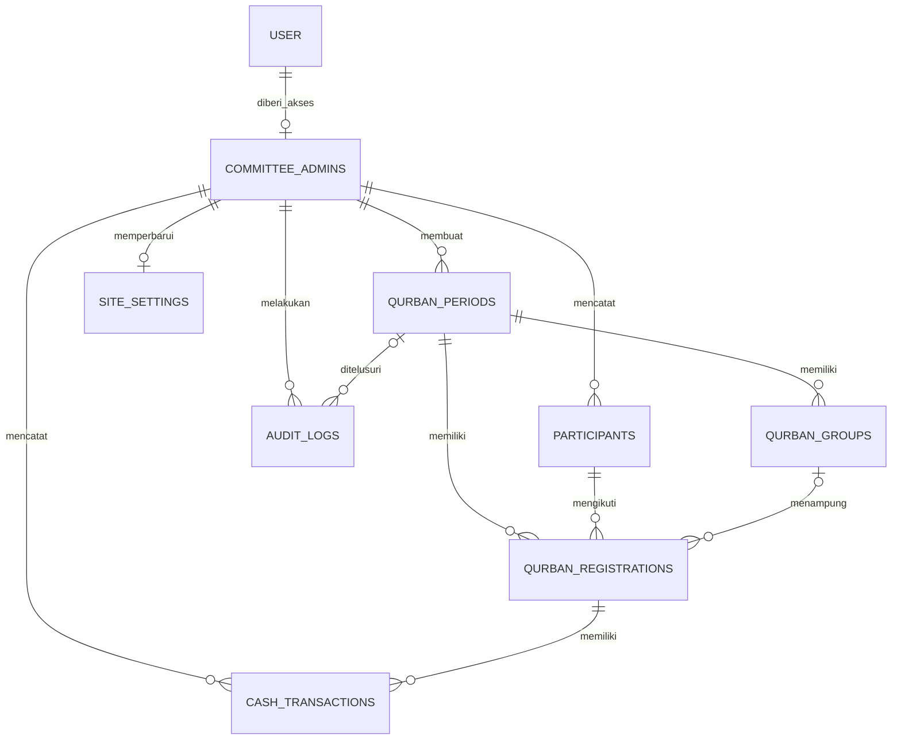
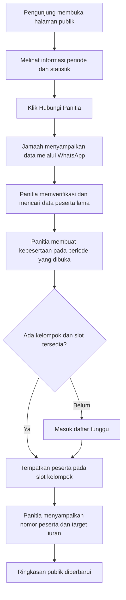

# Rancangan Aplikasi Iuran Qurban

Tanggal rancangan: 23 Oktober 2026.

## 1. Keputusan utama

**Disarankan menggunakan periode berdasarkan tahun pelaksanaan Iduladha.** Satu periode menampung peserta, kelompok sapi, dan pembayaran untuk satu tahun qurban. Iuran boleh dimulai sejak tahun sebelumnya; periode tidak harus mengikuti Januari–Desember.

Contoh: panitia membuat periode “Qurban 1448 H”, menetapkan tanggal pendaftaran, batas pelunasan, dan rencana pelaksanaan. Tanggal pelaksanaan diisi serta diperbarui panitia sesuai jadwal yang digunakan, bukan dihitung otomatis sebagai kepastian tanggal hari raya.

| Aspek                     | Dengan periode — rekomendasi                                    | Tanpa periode                                              |
| ------------------------- | --------------------------------------------------------------- | ---------------------------------------------------------- |
| Peserta dan kelompok sapi | Terpisah untuk setiap tahun pelaksanaan                         | Mudah tercampur dengan tahun sebelumnya                    |
| Iuran dan tunggakan       | Memiliki tujuan tahun dan batas pelunasan yang jelas            | Perlu penandaan tambahan agar tidak tercampur              |
| Informasi publik          | Menampilkan capaian periode tertentu                            | Angka seluruh tahun dapat disalahartikan sebagai tahun ini |
| Riwayat                   | Bisa melihat kembali laporan setiap tahun                       | Memerlukan pengelompokan ulang                             |
| Peserta yang ikut kembali | Data orang yang sama dipakai untuk kepesertaan tahun berikutnya | Berisiko mengubah riwayat kepesertaan lama                 |

Beberapa periode boleh disiapkan atau menerima iuran bersamaan untuk kebutuhan menabung lebih awal. Hanya satu periode menjadi sorotan halaman utama. Saldo tidak otomatis berpindah antarperiode.

Interpretasi konsep arisan pada rancangan ini adalah **iuran bersama untuk qurban pada periode yang dituju**. Semua peserta dalam satu kelompok ikut membiayai sapi kelompok tersebut. Undian, pemenang bergilir, dan piutang antarangkatan belum menjadi bagian dari sistem. Jika yang dimaksud arisan bergilir antartahun, diperlukan rancangan tambahan untuk siklus dan giliran penerima.

## 2. Pengguna dan pendaftaran

Hanya ada **satu jenis pengguna internal: admin/ketua panitia**. Beberapa orang panitia boleh memiliki akun masing-masing dengan kewenangan yang sama agar pencatat transaksi dapat diketahui. Jamaah tidak memiliki akses dashboard atau akun login.

Kalimat “panitia membuatkan akunnya” ditafsirkan sebagai panitia membuat **data peserta dan nomor kepesertaan**. Pendekatan ini mengikuti permintaan agar akses aplikasi hanya dimiliki admin/ketua panitia. Ringkasan jumlah peserta dan sapi dapat dilihat siapa saja melalui halaman publik.

| Pihak                                    | Akses                                                                         |
| ---------------------------------------- | ----------------------------------------------------------------------------- |
| Pengunjung/jamaah                        | Melihat informasi publik dan menghubungi panitia melalui WhatsApp             |
| Admin/ketua panitia aktif                | Mengelola periode, peserta, kelompok sapi, setoran, pengembalian, dan laporan |
| Akun login tanpa keanggotaan admin aktif | Tidak boleh mengakses atau mengubah data internal                             |

Pendaftaran dilakukan secara online dengan **menghubungi panitia**, bukan dengan mengisi form registrasi aplikasi. Tombol “Hubungi Panitia untuk Ikut Qurban” membuka WhatsApp dengan pesan awal berisi periode yang diminati. Percakapan tidak otomatis menjadi pendaftaran; panitia memverifikasi data lalu mencatatnya.

Perubahan autentikasi yang direncanakan:

1. Hapus halaman `/register`, komponen form registrasi, dan semua tautan pendaftaran mandiri.
2. Nonaktifkan endpoint signup publik di server. Menghapus form saja belum menutup pembuatan akun lewat API.
3. Sediakan pembuatan admin pertama melalui proses bootstrap pada server, menggunakan mekanisme hashing resmi library autentikasi. Tidak ada password bawaan dalam kode atau database seed.
4. Pembuatan akun panitia berikutnya hanya melalui proses internal yang memeriksa admin aktif. Akun panitia dinonaktifkan ketika tidak lagi bertugas.
5. Periksa sesi dan `committee_admins.is_active` pada setiap halaman internal, endpoint privat, dan Server Action. Akun lama tidak otomatis memperoleh akses admin.
6. Sesuaikan pengujian autentikasi lama yang saat ini masih memakai registrasi publik.

## 3. Aturan kelompok sapi dan harga

- Satu kelompok mewakili satu ekor sapi, dengan maksimal tujuh peserta aktif.
- Rekomendasi awal adalah tujuh peserta per kelompok agar beban biaya lebih ringan. Kelompok dengan satu sampai enam peserta tetap dapat difinalisasi setelah jumlah peserta dan pembagian biayanya disepakati.
- Satu orang mempunyai satu kepesertaan dalam satu periode dan dapat ikut lagi pada periode lain. Pendaftaran atas nama anggota keluarga dibuat sebagai peserta terpisah; nomor kontak keluarga boleh sama.
- Peserta yang belum mendapat kelompok masuk daftar tunggu. Peserta daftar tunggu belum menerima setoran karena target kelompoknya belum ditentukan.
- Harga dapat berbeda antarkelompok, tetapi target iuran semua peserta dalam kelompok yang sama harus sama.
- Kelompok boleh menerima cicilan saat masih terbentuk menggunakan estimasi yang diberitahukan sebagai sementara. Sebelum harga dikunci, panitia memastikan jumlah peserta sesuai `expected_members`.
- Setelah harga dan anggota dikunci, perubahan anggota atau harga harus melalui pembukaan kembali kelompok dengan alasan, audit, dan perhitungan ulang kewajiban. Proses ini hanya diperbolehkan sebelum pembelian sapi.
- Kelompok yang belum penuh tidak otomatis dianggap siap. Panitia melengkapi anggota, menyepakati pembagian baru dengan anggota yang ada, atau membatalkannya.

Rumus target iuran dalam rupiah utuh:

```text
N = jumlah peserta yang disepakati, antara 1 dan 7
target sementara per peserta = ceil(estimasi total biaya / N)
target final per peserta     = ceil(total biaya final / N)
selisih pembulatan kelompok  = (target final × N) − total biaya final
```

`final_total` adalah total biaya yang disepakati untuk dibebankan kepada kelompok, misalnya harga sapi ditambah biaya persiapan yang memang disepakati. `purchase_cost` adalah harga beli sapi yang sebenarnya. Keduanya dibedakan agar estimasi, kewajiban peserta, dan harga beli tidak tertukar.

Contoh: total biaya Rp28.000.000 dengan tujuh peserta menghasilkan target Rp4.000.000 per peserta. Setoran Rp500.000 sebanyak delapan kali memenuhi target tersebut. Sistem menerima nominal dan waktu cicilan yang fleksibel; jadwal bulanan dan denda otomatis belum diperlukan.

Jika biaya tidak habis dibagi jumlah peserta, semua peserta tetap membayar nominal yang sama setelah pembulatan ke atas. Selisihnya maksimal `N − 1` rupiah dan harus ditampilkan dalam laporan serta disepakati penggunaannya dalam catatan kelompok. Selisih tersebut tidak boleh dianggap otomatis sebagai pendapatan panitia. Panitia dapat memilih total biaya yang habis dibagi jumlah peserta untuk menghindari pembulatan.

Jika target final naik, peserta membayar kekurangan. Jika turun dan setoran bersih melebihi target baru, panitia mencatat pengembalian tunai sebelum kelompok dinyatakan selesai secara keuangan. Perubahan target harus diberitahukan kepada seluruh anggota kelompok.

## 4. Iuran tunai dan koreksi

Pembayaran hanya berupa **tunai yang diserahkan kepada panitia**. Sistem berfungsi mencatat penerimaan, bukan memproses pembayaran online. Tidak ada transfer, QRIS, payment gateway, atau unggah bukti transfer dalam alur utama.

Setiap transaksi memiliki nomor kuitansi unik, nominal, jenis transaksi, waktu penyerahan uang, petugas pencatat, dan catatan opsional. Permintaan penyimpanan menggunakan `idempotency_key` yang sama saat dicoba ulang agar klik ganda atau pengulangan jaringan tidak menghasilkan dua transaksi.

```text
setoran bersih = total deposit valid − total refund valid
sisa tagihan   = max(target iuran − setoran bersih, 0)
kelebihan      = max(setoran bersih − target iuran, 0)
```

Transaksi valid adalah transaksi yang `voided_at`-nya kosong. Saldo dan status pelunasan dihitung dari transaksi; keduanya tidak disimpan sebagai angka/status terpisah yang harus disinkronkan secara manual.

| Kondisi                             | Tindakan                                                                                        |
| ----------------------------------- | ----------------------------------------------------------------------------------------------- |
| Belum pernah membayar               | Tampilkan “Belum bayar”                                                                         |
| Setoran bersih di bawah target      | Tampilkan “Mencicil” dan sisa kewajiban                                                         |
| Setoran bersih sama dengan target   | Tampilkan “Lunas”; jika harga belum dikunci, labeli “Lunas estimasi”                            |
| Target turun sehingga ada kelebihan | Tampilkan “Perlu pengembalian” sampai diselesaikan                                              |
| Salah input nominal/peserta         | Void transaksi dengan alasan dan pencatat, lalu buat transaksi pengganti                        |
| Uang benar-benar dikembalikan       | Buat transaksi `refund`, jangan menggunakan void                                                |
| Peserta batal                       | Kembalikan setoran bersih sesuai kesepakatan, lalu batalkan kepesertaan; riwayat tetap disimpan |

Setoran baru yang melampaui sisa kewajiban ditolak. Pengembalian yang melebihi setoran bersih juga ditolak. Pemeriksaan saldo harus dilakukan dalam transaksi database dengan penguncian baris kepesertaan; dua petugas yang mencatat bersamaan tidak boleh sama-sama lolos memakai saldo lama.

Void atas transaksi lama juga harus memeriksa dampaknya. Contohnya, deposit yang sudah diikuti refund tidak boleh dibatalkan jika membuat setoran bersih negatif. Koreksi berantai dilakukan dalam satu transaksi database, disertai alasan dan audit.

Fitur laporan tahap awal adalah laporan iuran masuk, pengembalian, kewajiban peserta, dan data pembelian sapi. **Setoran bersih bukan saldo kas panitia yang tersedia**, karena pengeluaran operasional lengkap belum memiliki buku kas tersendiri. Buku kas pengeluaran terperinci dapat ditambahkan kemudian.

## 5. Status dan siklus data

### Periode

```text
draft → open → closed → completed → archived
```

| Status      | Arti dan tindakan yang diizinkan                                                         |
| ----------- | ---------------------------------------------------------------------------------------- |
| `draft`     | Pengaturan awal; belum tampil pada publik dan belum menerima peserta/setoran             |
| `open`      | Menerima pendaftaran dan iuran sesuai rentang tanggal                                    |
| `closed`    | Pendaftaran ditutup; pelunasan dan pengembalian masih dapat diselesaikan                 |
| `completed` | Pelaksanaan selesai dan kewajiban keuangan sudah direkonsiliasi; data menjadi hanya baca |
| `archived`  | Riwayat periode disimpan; data tetap hanya baca                                          |

Status tidak berubah hanya karena tanggal berlalu. Server tetap memeriksa status dan tanggal pada setiap operasi. Pendaftaran hanya diterima saat `open` dan di dalam rentang pendaftaran. Iuran diterima pada `open`/`closed` sampai batas pelunasan. Pengecualian batas tanggal atau pembukaan kembali periode harus eksplisit, memiliki alasan dan audit. Refund tetap dapat diselesaikan setelah batas pelunasan sebelum periode diselesaikan.

### Kelompok sapi

```text
forming → collecting → ready → purchased → slaughtered
forming / collecting / ready → cancelled
```

Cabang `cancelled` hanya untuk pembatalan sebelum pembelian setelah kewajiban kepada peserta dibereskan; bukan status yang dilanjutkan kembali ke `ready`.

| Status        | Arti                                                                                                                     |
| ------------- | ------------------------------------------------------------------------------------------------------------------------ |
| `forming`     | Anggota sedang dikumpulkan; target masih berupa estimasi                                                                 |
| `collecting`  | Komposisi anggota sudah disepakati dan iuran sedang dilengkapi                                                           |
| `ready`       | Harga final terkunci, jumlah anggota sesuai kesepakatan, seluruh anggota lunas, dan kelebihan setoran sudah diselesaikan |
| `purchased`   | Sapi sudah dibeli; harga beli dan waktu pembelian tercatat                                                               |
| `slaughtered` | Sapi sudah dilaksanakan qurbannya; waktu pelaksanaan tercatat                                                            |
| `cancelled`   | Kelompok dibatalkan; tidak masuk angka sapi yang direncanakan                                                            |

Kesiapan tidak boleh dinilai dari total uang kelompok saja. Semua peserta harus memenuhi kewajibannya masing-masing. Nominal salah satu peserta yang berlebih tidak menutup tunggakan peserta lain secara otomatis. Jika ada koreksi yang membuat kelompok tidak memenuhi syarat sebelum pembelian, statusnya dikembalikan dari `ready` ke `collecting` dalam transaksi yang sama.

## 6. Skema database

Database mengikuti proyek yang sudah ada: PostgreSQL dengan Drizzle ORM dan tabel autentikasi Better Auth. Tabel autentikasi hasil generator tidak diubah. Penambahan domain berada pada `src/db/schema/qurban.ts` dan diekspor melalui `src/db/schema/index.ts`.

Delapan tabel domain ditambahkan di samping empat tabel autentikasi yang sudah ada.

### 6.1 Tabel autentikasi yang dipertahankan

| Tabel          | Fungsi                                             |
| -------------- | -------------------------------------------------- |
| `user`         | Identitas akun panitia untuk login                 |
| `account`      | Kredensial dan hash password yang dikelola library |
| `session`      | Sesi login                                         |
| `verification` | Data verifikasi autentikasi                        |

### 6.2 `committee_admins` — daftar admin yang diizinkan

| Kolom                      | Tipe / aturan                                         |
| -------------------------- | ----------------------------------------------------- |
| `user_id`                  | `text`, primary key dan FK ke `user.id`               |
| `is_active`                | `boolean`, default `true`                             |
| `created_by`               | FK ke `user.id`, boleh kosong untuk bootstrap pertama |
| `created_at`, `updated_at` | `timestamptz`                                         |

Tidak ada role peserta, bendahara, atau akses terpisah lainnya. Keberadaan akun di tabel `user` saja tidak cukup untuk mendapat akses admin. Penonaktifan admin mempertahankan referensi historis transaksi.

### 6.3 `site_settings` — informasi publik panitia

| Kolom                            | Tipe / aturan                                                                                  |
| -------------------------------- | ---------------------------------------------------------------------------------------------- |
| `id`                             | `integer`, primary key; hanya nilai `1`, satu baris pengaturan                                 |
| `committee_name`, `contact_name` | Nama panitia dan narahubung                                                                    |
| `whatsapp_number`                | Nomor internasional berbentuk digit, misalnya `62812…`, tanpa tanda `+`, untuk tautan WhatsApp |
| `public_description`             | Deskripsi program untuk halaman publik                                                         |
| `updated_by`, `updated_at`       | Admin pengubah dan waktu perubahan                                                             |

### 6.4 `qurban_periods` — periode pelaksanaan

| Kolom                                             | Tipe / aturan                                                                        |
| ------------------------------------------------- | ------------------------------------------------------------------------------------ |
| `id`                                              | `uuid`, primary key                                                                  |
| `name`                                            | Nama periode, tidak boleh kosong                                                     |
| `hijri_year`                                      | Bilangan positif dan unik; satu periode per tahun Hijriah dalam aplikasi panitia ini |
| `registration_starts_on`, `registration_ends_on`  | `date`, masa pendaftaran sekaligus awal penerimaan iuran                             |
| `payment_due_on`, `qurban_on`                     | `date`, tenggat pelunasan dan rencana pelaksanaan                                    |
| `status`                                          | Enum status periode                                                                  |
| `is_featured`                                     | Periode sorotan; maksimal satu baris bernilai `true`, tidak boleh `draft`            |
| `notes`, `created_by`, `created_at`, `updated_at` | Catatan dan informasi pencatatan                                                     |

Database memastikan urutan tanggal: awal pendaftaran ≤ akhir pendaftaran ≤ batas pelunasan ≤ tanggal pelaksanaan. Tanggal ditafsirkan menurut zona waktu panitia yang ditetapkan untuk aplikasi; waktu transaksi disimpan sebagai `timestamptz`.

### 6.5 `participants` — data jamaah

| Kolom                                    | Tipe / aturan                                                                           |
| ---------------------------------------- | --------------------------------------------------------------------------------------- |
| `id`                                     | `uuid`, primary key                                                                     |
| `full_name`                              | Nama jamaah, wajib dan tidak kosong                                                     |
| `phone`                                  | Nomor kontak internasional yang dinormalisasi; tidak unik karena dapat dipakai keluarga |
| `address`, `notes`                       | Opsional, hanya untuk panitia                                                           |
| `archived_at`                            | Waktu pengarsipan; menggantikan penghapusan data bersejarah                             |
| `created_by`, `created_at`, `updated_at` | Informasi pencatatan                                                                    |

Peserta tidak memiliki password atau relasi akun login. Panitia mencari peserta lama sebelum membuat data baru untuk mengurangi duplikasi; nomor telepon tidak digunakan sebagai identitas tunggal.

### 6.6 `qurban_groups` — satu baris untuk satu sapi

| Kolom                                             | Tipe / aturan                                                              |
| ------------------------------------------------- | -------------------------------------------------------------------------- |
| `id`, `period_id`                                 | Primary key UUID dan FK periode                                            |
| `code`                                            | Kode kelompok, unik dalam periode, misalnya `SAPI-01`                      |
| `expected_members`                                | Bilangan `1–7`, default `7`; pembagi target iuran                          |
| `estimated_total`                                 | `numeric(14,0)`, estimasi total biaya, harus positif                       |
| `final_total`, `price_locked_at`                  | Total biaya final dan waktu penguncian; harus sama-sama terisi atau kosong |
| `status`                                          | Enum status kelompok                                                       |
| `purchase_cost`, `purchased_at`                   | Harga beli sapi dan waktu pembelian; harus sama-sama terisi atau kosong    |
| `slaughtered_at`                                  | Waktu pelaksanaan, wajib pada status `slaughtered`                         |
| `notes`, `created_by`, `created_at`, `updated_at` | Catatan kesepakatan, pembulatan, serta informasi pencatatan                |

`numeric(14,0)` digunakan untuk rupiah utuh dan dibaca sebagai string oleh driver. Layanan harus menolak nominal pecahan sebelum penyimpanan dan menggunakan aritmetika bilangan bulat/presisi tepat. Hindari kalkulasi uang dengan floating point.

### 6.7 `qurban_registrations` — kepesertaan per periode

| Kolom                                                 | Tipe / aturan                                                                            |
| ----------------------------------------------------- | ---------------------------------------------------------------------------------------- |
| `id`, `period_id`, `participant_id`                   | Primary key UUID dan FK ke periode serta peserta                                         |
| `registration_number`                                 | Nomor kepesertaan, unik dalam periode                                                    |
| `qurban_name`                                         | Nama atas nama qurban pada periode ini; menyimpan riwayat jika nama data peserta berubah |
| `group_id`, `slot_number`                             | Kelompok dan slot `1–7`; keduanya terisi atau keduanya kosong untuk daftar tunggu        |
| `status`                                              | `active` atau `cancelled`                                                                |
| `registered_at`                                       | Waktu pendaftaran                                                                        |
| `cancelled_at`, `cancelled_by`, `cancellation_reason` | Wajib lengkap bila dibatalkan; kosong bila aktif                                         |
| `notes`, `created_by`, `created_at`, `updated_at`     | Informasi pencatatan                                                                     |

Constraint penting:

- Unik `(participant_id, period_id)` mencegah satu orang mendapat dua kepesertaan pada tahun yang sama. Pendaftaran batal yang diaktifkan kembali memakai baris yang sama dan dicatat dalam audit.
- FK gabungan `(group_id, period_id)` memastikan kelompok sapi berasal dari periode kepesertaan yang sama.
- Slot hanya `1–7`, dan indeks unik parsial `(group_id, slot_number)` untuk kepesertaan aktif memastikan satu sapi tidak bisa mempunyai delapan peserta aktif, termasuk pada penulisan bersamaan.
- Kepesertaan batal tetap menyimpan kelompok/slot lama untuk riwayat, tetapi tidak memblokir penggunaan kembali slot tersebut.

### 6.8 `cash_transactions` — setoran dan pengembalian tunai

| Kolom                                   | Tipe / aturan                                                            |
| --------------------------------------- | ------------------------------------------------------------------------ |
| `id`, `registration_id`                 | Primary key UUID dan FK ke kepesertaan, sehingga tujuan periodenya jelas |
| `entry_type`                            | `deposit` atau `refund`                                                  |
| `amount`                                | `numeric(14,0)`, harus lebih dari nol                                    |
| `payment_method`                        | Hanya nilai `cash`, dijaga CHECK constraint                              |
| `receipt_number`                        | Nomor kuitansi unik                                                      |
| `idempotency_key`                       | UUID unik, dikirim pemanggil dan dipakai kembali saat retry              |
| `transacted_at`, `recorded_by`          | Waktu serah terima uang dan petugas pencatat                             |
| `notes`                                 | Catatan opsional                                                         |
| `voided_at`, `voided_by`, `void_reason` | Informasi void; harus lengkap atau semuanya kosong                       |
| `created_at`                            | Waktu pencatatan dalam sistem                                            |

Trigger database melarang penghapusan transaksi dan perubahan rincian transaksi yang telah dicatat. Satu-satunya perubahan yang diperbolehkan adalah void satu kali dengan informasi lengkap. Transaksi void tidak dapat dipulihkan atau diubah. Pengembalian uang menggunakan baris `refund` baru dan nominal tetap positif.

### 6.9 `audit_logs` — jejak perubahan

| Kolom                      | Tipe / aturan                                                                        |
| -------------------------- | ------------------------------------------------------------------------------------ |
| `id`, `actor_id`           | Primary key UUID dan admin pelaku                                                    |
| `period_id`                | FK periode, opsional untuk perubahan umum seperti pengaturan                         |
| `action`                   | Jenis tindakan, misalnya `registration_created`, `cash_voided`, `group_price_locked` |
| `entity_type`, `entity_id` | Objek yang diubah; ID berupa `text` agar mendukung UUID domain dan ID akun           |
| `metadata`                 | `jsonb`, rincian perubahan seperlunya                                                |
| `created_at`               | Waktu tindakan                                                                       |

Audit bersifat append-only: trigger menolak UPDATE dan DELETE. `entity_id` adalah referensi polimorfik untuk penelusuran, bukan FK universal. Jangan mencatat password, token sesi, atau rahasia autentikasi pada metadata.

### 6.10 Relasi utama



Foreign key penting menggunakan `ON DELETE RESTRICT` agar data peserta, kelompok, admin, atau periode yang memiliki riwayat tidak terhapus berantai. Indeks disediakan pada relasi FK, filter periode/status, nomor kontak, riwayat transaksi, dan penelusuran audit.

## 7. Batas validasi database dan layanan

Skema dan migrasi awal sudah menerapkan aturan struktural. Aturan yang memerlukan pemeriksaan beberapa baris akan diterapkan pada lapisan layanan ketika fitur operasional dibangun.

| Sudah dijaga database                                                   | Harus dibangun pada layanan/server                                                                    |
| ----------------------------------------------------------------------- | ----------------------------------------------------------------------------------------------------- |
| Maksimal tujuh slot aktif dan tidak ada slot ganda                      | Slot sesuai `expected_members`; jumlah anggota tepat saat harga dikunci                               |
| Peserta dan kelompok berada di periode yang sama                        | Status/tanggal periode mengizinkan tindakan                                                           |
| Satu kepesertaan per orang per periode                                  | Pencarian data orang untuk menghindari pembuatan dua identitas orang yang sama                        |
| Nominal positif, metode hanya tunai                                     | Input rupiah utuh; setoran tidak melampaui target; refund/void tidak membuat saldo negatif            |
| Kuitansi dan idempotency key unik                                       | Penanganan retry mengembalikan hasil transaksi lama dan memeriksa payload yang sama                   |
| Informasi void lengkap; transaksi tidak dapat dihapus/diubah nominalnya | Audit wajib ditulis dalam transaksi yang sama dengan setiap perubahan domain                          |
| Harga final wajib untuk status siap                                     | Semua anggota lunas, anggota sesuai kesepakatan, kelebihan selesai sebelum `ready`                    |
| Harga dan waktu pembelian berpasangan                                   | Urutan transisi status yang benar, anggaran pembelian cukup, anggota/harga terkunci setelah pembelian |
| Referensi admin ada pada `committee_admins`                             | Sesi valid dan admin masih aktif pada setiap akses                                                    |
| Audit tidak dapat diedit/dihapus                                        | Otorisasi pembukaan kembali, pembatalan, dan koreksi                                                  |

Untuk mutasi keuangan, urutan penguncian dibuat konsisten: periode → kelompok → kepesertaan. Kunci baris dengan `SELECT … FOR UPDATE`, hitung ulang saldo/target, tulis transaksi beserta audit, perbarui kesiapan bila perlu, kemudian commit. Tidak ada operasi jaringan eksternal di dalam transaksi database tersebut. Antarmuka menampilkan hasil setelah commit dan memperbarui ringkasan terkait.

## 8. Halaman publik

Halaman utama menampilkan nama program, periode sorotan, penjelasan iuran tunai, statistik, tenggat pendaftaran/pelunasan, dan tombol WhatsApp panitia. Tanpa periode sorotan yang dipublikasikan, tampilkan pesan “Informasi periode qurban akan diumumkan panitia”, bukan angka seluruh periode yang dijumlahkan.

| Informasi                   | Sumber dan definisi                                                                     |
| --------------------------- | --------------------------------------------------------------------------------------- |
| Jamaah terdaftar            | Jumlah kepesertaan `active` pada periode sorotan, termasuk yang masih menunggu kelompok |
| Jamaah mendapat kelompok    | Jumlah kepesertaan aktif dengan kelompok yang tidak dibatalkan                          |
| Sapi direncanakan           | Jumlah kelompok tidak batal yang memiliki minimal satu peserta aktif                    |
| Sapi sudah didanai          | Kelompok berstatus `ready`, `purchased`, atau `slaughtered`                             |
| Sapi sudah dibeli/disiapkan | Kelompok berstatus `purchased` atau `slaughtered`                                       |
| Sapi sudah dikurbankan      | Kelompok berstatus `slaughtered`                                                        |

Dua angka utama adalah **jamaah terdaftar** dan **sapi direncanakan**. Angka sapi dibeli/dikurbankan ditampilkan sebagai perkembangan pelaksanaan. Label “direncanakan” tidak boleh diganti menjadi “sudah berkurban” sebelum pelaksanaan.

Contoh: sepuluh jamaah pada dua kelompok ditampilkan sebagai “10 jamaah terdaftar · 2 sapi direncanakan”. Jika baru kelompok pertama yang lunas, tampilkan tambahan “1 sapi sudah didanai”. Perhitungan sapi menggunakan kelompok nyata, bukan otomatis `ceil(total peserta / 7)`, karena pembagian kelompok dapat berbeda.

Data publik hanya berupa agregat dan kontak panitia yang memang dipublikasikan. Nama peserta, nomor telepon jamaah, alamat, cicilan individual, dan kuitansi tidak ditampilkan. Query publik menggunakan daftar kolom yang eksplisit, tanpa mengirim objek peserta atau tabel autentikasi. Cache publik diperbarui setelah perubahan terkait atau menggunakan batas kesegaran yang jelas; data antarperiode tidak dicampur.

## 9. Menu admin yang direncanakan

| Menu              | Fungsi                                                                                   |
| ----------------- | ---------------------------------------------------------------------------------------- |
| Dashboard         | Ringkasan periode terpilih, peserta, kelompok, iuran masuk, refund, dan sisa kewajiban   |
| Periode           | Jadwal, status, sorotan publik, dan riwayat                                              |
| Peserta           | Data jamaah, pendaftaran per periode, daftar tunggu, dan status iuran                    |
| Kelompok Sapi     | Anggota maksimal tujuh orang, estimasi/final biaya, status kesiapan dan pembelian        |
| Iuran Tunai       | Input setoran, kuitansi, refund, void, dan riwayat                                       |
| Laporan           | Rekap peserta/kelompok, setoran valid, refund, sisa kewajiban, dan pembelian per periode |
| Informasi Publik  | Nama panitia, narahubung, WhatsApp, dan deskripsi program                                |
| Akun Panitia      | Pengelolaan admin aktif dan akun pribadi                                                 |
| Riwayat Aktivitas | Penelusuran perubahan penting                                                            |

## 10. Workflow sistem

### A. Persiapan panitia

1. Siapkan admin pertama melalui proses bootstrap internal.
2. Admin login, lalu server memeriksa sesi dan status admin aktif.
3. Isi informasi panitia dan kontak WhatsApp yang boleh dipublikasikan.
4. Buat periode beserta jadwal pendaftaran, batas pelunasan, dan rencana pelaksanaan.
5. Buat kelompok sapi dengan estimasi biaya dan target jumlah anggota.
6. Buka periode dan pilih periode sorotan publik.

### B. Jamaah mendaftar



### C. Jamaah menyetor tunai

1. Jamaah menyerahkan uang tunai kepada panitia.
2. Panitia mencari nomor peserta dan memastikan periode serta kelompok tujuan.
3. Server memeriksa admin aktif, status periode, target, dan sisa kewajiban.
4. Dalam transaksi database, server mengunci baris terkait dan menghitung ulang angka keuangan.
5. Simpan `deposit` dengan idempotency key, nomor kuitansi, nominal, waktu, dan petugas.
6. Simpan audit dalam transaksi yang sama, lalu commit.
7. Tampilkan kuitansi yang dapat dicetak/dibagikan oleh panitia serta total setoran dan sisa kewajiban.
8. Perbarui dashboard dan evaluasi kesiapan kelompok. Pelunasan estimasi tidak langsung berarti siap sebelum harga final dikunci.

### D. Harga final, pembelian, dan pelaksanaan

1. Panitia memastikan komposisi anggota dan total biaya final telah disepakati.
2. Server memeriksa anggota aktif sama dengan `expected_members`, lalu mengunci harga dan anggota dengan audit.
3. Sistem menghitung kembali target; panitia menyelesaikan kekurangan atau pengembalian bila ada.
4. Ketika semua anggota lunas dan tidak ada kelebihan yang belum dibereskan, kelompok menjadi `ready`.
5. Panitia membeli sapi, mencatat harga beli/waktu pembelian, dan mengubah status menjadi `purchased`.
6. Setelah pelaksanaan, panitia mencatat waktu dan status `slaughtered`.
7. Publik melihat perkembangan jumlah sapi direncanakan, didanai, dibeli, dan dikurbankan.

### E. Pembatalan dan pergantian peserta

1. Panitia memeriksa apakah sapi belum dibeli dan kelompok masih boleh dibuka kembali.
2. Jika harga/anggota sudah dikunci, buka kembali kelompok dengan alasan dan audit terlebih dahulu.
3. Hitung setoran bersih peserta. Catat pengembalian tunai sampai saldo peserta nol; jangan menghapus setoran lama.
4. Batalkan kepesertaan dengan alasan, waktu, dan admin pelaku dalam transaksi yang sama dengan perubahan terkait.
5. Slot dapat digunakan peserta pengganti. Sepakati ulang jumlah anggota, target, dan harga terkunci sebelum kelompok siap kembali.
6. Transfer saldo langsung antarpeserta atau antarperiode belum disediakan. Jika berpindah periode, catat refund pada periode lama dan deposit baru pada periode tujuan sebagai kejadian tunai yang sebenarnya.

### F. Penutupan periode

1. Tutup pendaftaran tanpa menghentikan penyelesaian iuran/refund yang masih diperbolehkan.
2. Selesaikan peserta batal, daftar tunggu, dan kelompok yang tidak jadi dilaksanakan.
3. Pastikan semua kelompok yang dilaksanakan sudah `slaughtered`, kelompok batal tidak memiliki kewajiban tertinggal, dan seluruh selisih telah dijelaskan.
4. Rekonsiliasi laporan iuran dan pengembalian dengan catatan tunai panitia.
5. Tandai periode `completed` lalu arsipkan. Periode selesai/arsip hanya dapat dibaca; koreksi memerlukan pembukaan kembali yang diaudit.
6. Untuk tahun berikutnya, buat periode baru dan gunakan kembali data peserta tanpa menyalin saldo.

## 11. Rencana implementasi bertahap

| Tahap                              | Pekerjaan                                                                                                                                | Hasil / kriteria selesai                                                                  |
| ---------------------------------- | ---------------------------------------------------------------------------------------------------------------------------------------- | ----------------------------------------------------------------------------------------- |
| 0 — rancangan dan database         | Dokumen ini, definisi Drizzle, migrasi tabel/index/constraint, trigger penjaga riwayat, pengujian database                               | Fondasi data tersedia dan aturan struktural teruji                                        |
| 1 — akses khusus panitia           | Bootstrap admin, penutupan signup API, penghapusan form/tautan register, guard admin aktif pada semua jalur privat, penyesuaian tes auth | Jamaah tidak bisa membuat akun atau mengakses dashboard; admin yang disiapkan dapat login |
| 2 — operasi iuran                  | Layanan periode, peserta, daftar tunggu, pengelompokan, harga final, deposit/refund/void, audit atomik, penguncian saldo, kuitansi       | Alur daftar sampai lunas dapat dipakai panitia tanpa saldo atau slot ganda                |
| 3 — dashboard dan informasi publik | Menu operasional, agregat publik per periode, CTA WhatsApp, kesiapan/pembelian/pelaksanaan                                               | Publik memperoleh angka yang benar dan panitia dapat memantau pelaksanaan                 |
| 4 — laporan dan penutupan          | Rekap/cetak laporan, rekonsiliasi, periode selesai/arsip, pengujian menyeluruh                                                           | Riwayat tiap tahun dapat ditelusuri dan tidak berubah tanpa proses koreksi                |

Fitur di luar tahap awal: akun jamaah, undian arisan bergilir, pembayaran nontunai, denda otomatis, notifikasi WhatsApp otomatis, aplikasi banyak panitia/masjid, dan buku kas pengeluaran lengkap. Tombol WhatsApp pada tahap awal hanya membuka percakapan; aplikasi tidak mengirim pesan otomatis.

## 12. Status pekerjaan pada tahap ini

Pada tahap fondasi awal, pekerjaan menyiapkan database dan dokumen. Status ini merupakan catatan historis; perkembangan frontend dicatat pada bagian 15 dan integrasi backend pada bagian 16.

Artefak yang disiapkan:

- `rancangan.md`: keputusan, skema, rencana implementasi, dan workflow.
- `src/db/schema/qurban.ts`: delapan tabel domain dan empat enum status/jenis transaksi.
- `src/db/schema/index.ts`: ekspor schema domain.
- `drizzle/0001_qurban_core.sql` beserta metadata: migrasi tambahan tanpa mengubah migrasi autentikasi awal.
- `drizzle/0002_qurban_history_guards.sql` beserta metadata: penjaga riwayat transaksi dan audit.
- `scripts/check-qurban-schema.mjs`: pengujian integritas langsung terhadap PostgreSQL; seluruh fixture selalu di-rollback.

Migrasi sudah diterapkan pada PostgreSQL lokal proyek (`localhost:5432/qurban`). Tidak dibuat akun panitia, peserta, atau transaksi nyata pada tahap ini. Pengujian database mencakup batas tujuh slot, slot ganda, kepesertaan lintas periode, peserta berulang per periode, pembatalan dan pemakaian kembali slot, transaksi tunai, keunikan kuitansi/idempotency key, larangan perubahan/penghapusan riwayat, void, serta perhitungan setoran bersih dengan refund dan void.

Hasil verifikasi tahap ini: 33 pemeriksaan database lulus dan seluruh fixture di-rollback; `pnpm lint` dan `pnpm typecheck` lulus; 16 unit test yang sudah ada lulus. Format dokumen, schema, dan script pengujian juga sudah diperiksa dengan Prettier. Pengujian alur operasional baru pada bagian 13 menunggu implementasi tahap berikutnya.

Perintah untuk checkout/database lain yang sudah dikonfigurasi:

```sh
pnpm db:migrate
node scripts/check-qurban-schema.mjs
```

Gunakan migrasi yang disertakan. Hindari `db:push` untuk menyiapkan lingkungan ini karena trigger penjaga riwayat berada dalam migrasi SQL khusus dan tidak terbentuk hanya dari deklarasi tabel TypeScript. `updated_at` pada tabel domain diperbarui oleh Drizzle ketika memakai ORM; SQL manual harus mengisinya sendiri.

## 13. Verifikasi lanjutan saat fitur dibangun

Selain integritas skema yang sudah diuji, implementasi layanan dan antarmuka harus membuktikan skenario berikut:

1. Pengunjung tidak bisa signup melalui UI maupun API; sesi nonadmin/admin nonaktif ditolak di semua jalur privat.
2. Pembuatan admin pertama berhasil tanpa membuka endpoint bootstrap publik.
3. Dua admin mencoba mengisi slot terakhir bersamaan: hanya satu berhasil dan tampilan lainnya mendapat pesan slot sudah terisi.
4. Dua setoran/refund bersamaan tidak menyebabkan kelebihan setoran atau saldo negatif; retry payload yang berbeda dengan key sama ditolak.
5. Kelompok dengan tujuh anggota tetapi satu menunggak belum dianggap siap meskipun total dana cukup akibat data koreksi/kelebihan anggota lain.
6. Penguncian kelompok kurang dari tujuh anggota menghitung target rata sesuai jumlah yang disepakati; perubahan harga menghasilkan kekurangan/pengembalian yang benar.
7. Pembatalan tidak menghilangkan riwayat, dan kelompok yang telah dibeli tidak menerima perubahan anggota/harga biasa.
8. Periode yang belum dibuka, sudah melewati batas tanggal, selesai, dan arsip menerapkan pembatasan yang benar di server.
9. Statistik publik terfilter periode, mengabaikan peserta/kelompok batal, serta tidak membocorkan data pribadi.
10. Input setoran/refund/void dan auditnya bersifat atomik: seluruhnya berhasil atau seluruhnya dibatalkan.

## 14. Acuan teknis

- [Drizzle: PostgreSQL indexes dan constraints](https://orm.drizzle.team/docs/indexes-constraints) — diakses melalui Context7 untuk deklarasi CHECK, UNIQUE, indeks parsial, dan FK gabungan.
- [Drizzle: custom migrations](https://orm.drizzle.team/docs/kit-custom-migrations) — migrasi khusus untuk trigger penjaga riwayat.
- [Postgres.js: transactions](https://github.com/porsager/postgres#transactions) — diakses melalui Context7 untuk transaksi dan savepoint pada pengujian.
- Panduan Next.js versi terpasang dibaca dari `node_modules/next/dist/docs/`, terutama panduan authentication, Server/Client Components, dan Route Handlers, sesuai `AGENTS.md` proyek.

## 15. Implementasi frontend terlebih dahulu

Seluruh halaman frontend tersedia: halaman publik, login khusus panitia, sembilan menu admin, detail peserta, detail kelompok, dan kuitansi tunai. `/register` mengarah ke `/login`; form dan tautan registrasi mandiri telah dihapus.

Pratinjau lengkap tersedia di `/preview/dashboard` tanpa login. Dataset sintetis berada pada `src/lib/qurban-demo.ts`; state dibagi antarmenu melalui `DemoProvider`. Seluruh mutasi hanya mengubah data contoh dalam memori dan direset saat reload. Tidak ada migrasi tambahan atau penulisan data domain ke PostgreSQL pada tahap frontend.

Antarmuka menyediakan pencarian/filter, pagination, formulir tervalidasi, daftar tunggu, pengelompokan maksimal tujuh anggota, estimasi/final biaya, penguncian dan pembukaan kembali, pembelian/pelaksanaan, setoran/refund/void, kuitansi cetak, laporan/CSV, pengaturan publik beserta pratinjau, akun panitia contoh, dan riwayat aktivitas. Tema terang/gelap, layout ponsel, loading, empty state, dan pesan kesalahan disediakan.

Aturan keuangan pada antarmuka membantu demonstrasi. Bagian 16 mencatat implementasi server berikutnya; `/preview` tetap merupakan data contoh dalam memori.

## 16. Backend dan integrasi frontend

Backend operasional dan koneksi PostgreSQL sudah terpasang untuk seluruh menu. Halaman nyata mengambil snapshot database dan mengirim command tervalidasi; halaman publik mengambil agregat periode sorotan. Pembuatan periode, peserta baru/lama, daftar tunggu, penempatan, penguncian harga, pembelian/pelaksanaan, setoran/refund/void, koreksi berantai, laporan, pengaturan publik, dan akun panitia telah dihubungkan.

Signup publik ditutup pada Better Auth dan handler HTTP. Bootstrap admin hanya melalui `scripts/bootstrap-admin.mjs`, memakai hashing resmi dan transaksi database; tidak ada password bawaan. Sesi nonadmin/nonaktif ditolak. Semua halaman privat, API, dan Server Action memeriksa admin aktif; mutasi memeriksa ulang admin di transaksi yang sama. Akun nonaktif kehilangan seluruh sesi.

Mutasi keuangan mengunci periode, kelompok, dan kepesertaan, menghitung ulang saldo, memvalidasi tanggal server di `Asia/Jakarta`, menyimpan transaksi/audit, dan mengevaluasi ulang kesiapan sebelum commit. UUID permintaan dipakai kembali pada retry. Key sama dengan payload berbeda ditolak. Koreksi berantai memakai satu transaksi dan tidak boleh menghasilkan saldo negatif. Harga/anggota tidak dibuka kembali setelah sapi dibeli.

Periode selesai/arsip hanya baca; pembukaan kembali dan perubahan jadwal membutuhkan alasan. Penggunaan sorotan publik tidak memindahkan saldo. Agregat publik tidak memuat data pribadi atau transaksi individual dan dibaca tanpa cache lintas periode. Laporan dan kuitansi nyata memakai data tersimpan; penanda data contoh hanya tampil pada `/preview`.

Migrasi `0003_bent_ma_gnuci.sql` menambah jenis sapi dan alamat sekretariat, serta mendukung kontak WhatsApp yang belum diisi. Migrasi ini sudah diterapkan tanpa mengubah tabel autentikasi generator atau mengisi peserta/transaksi contoh pada database utama.

Runner `pnpm test:backend` memakai database terisolasi yang dibuat dan dihapus otomatis. Cakupannya meliputi bootstrap pertama/ulang, penutupan signup, guard sesi aktif/nonaktif, CSRF, persistensi UI, slot terakhir bersamaan, deposit/refund bersamaan, idempotensi, koreksi rollback, pembulatan, pembatalan/pengaktifan, penggunaan peserta lama, tenggat aktual, pembelian/pelaksanaan, arsip, privasi publik, serta perubahan password.
